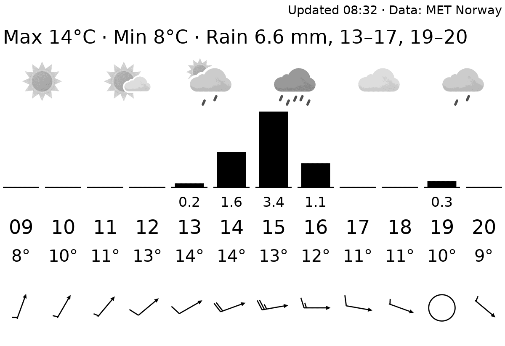
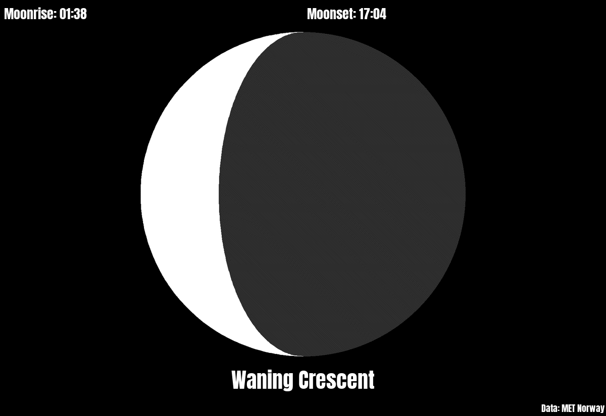
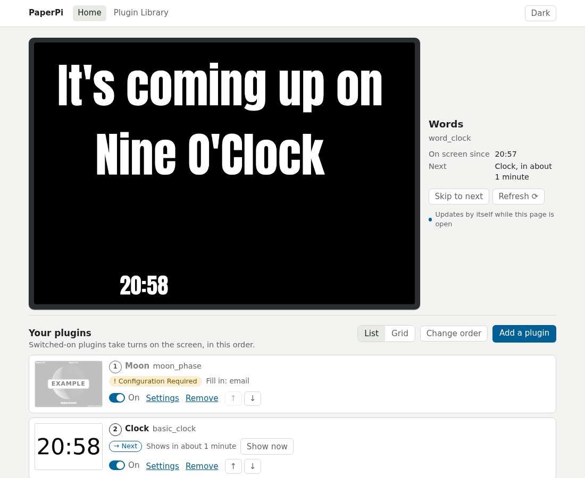

# PaperPi

PaperPi shows information on an e-paper screen attached to a Raspberry Pi: clocks, the weather, your calendar, what music is playing, comics, public transport departures and more. The screen shows one plugin at a time and changes to the next at the pace you choose. You set it up in a web page on your phone or computer; no config files to edit.

**The manual: <https://txoof.github.io/PaperPi/>**

| | | | |
|---|---|---|---|
|  |  |  |  |
| [Word clock](https://txoof.github.io/PaperPi/plugins/word_clock/) | [Weather](https://txoof.github.io/PaperPi/plugins/met_no/) | [Moon phase](https://txoof.github.io/PaperPi/plugins/moon_phase/) | [xkcd comic](https://txoof.github.io/PaperPi/plugins/xkcd_comic/) |

All plugins, with pictures and their settings: [Plugins](https://txoof.github.io/PaperPi/plugins/).

## What you need

- A Raspberry Pi 3 or newer with Raspberry Pi OS "trixie", on your home network.
- An e-paper screen: one with Waveshare's IT8951 board (such as the Waveshare 9.7") or one of Waveshare's small screens on the e-Paper HAT. Which ones work: [Supported screens](https://txoof.github.io/PaperPi/screens/).
- An internet connection for the plugins that fetch information, such as the weather.

How to connect the screen: [Hardware](https://txoof.github.io/PaperPi/hardware/).

## Install

1. Log in to the Pi, with a keyboard and screen or from another computer with SSH (`ssh <user>@<the Pi's name or address>`).
2. Run this command. It downloads the install script and runs it as administrator:

    ```bash
    curl -fsSL https://raw.githubusercontent.com/txoof/PaperPi/main/install/paperpi-install | sudo bash
    ```

3. Answer its questions: which screen is connected and its size. Then wait a few minutes while it installs PaperPi and starts it. PaperPi then starts by itself every time the Pi starts.
4. The screen shows a QR code and a web address. Scan the code with your phone or type the address into a browser on the same network, and choose what the screen shows.

Every question explained, and installing without questions: [Install](https://txoof.github.io/PaperPi/install/). The first steps in the web page: [First Setup](https://txoof.github.io/PaperPi/first-setup/).

To update to the newest version later:

```bash
sudo paperpi-install update
```

## The manual

| Page | What it covers |
|---|---|
| [Hardware](https://txoof.github.io/PaperPi/hardware/) | Which Pi and screen, and how to connect them |
| [Install](https://txoof.github.io/PaperPi/install/) | The install, step by step |
| [First Setup](https://txoof.github.io/PaperPi/first-setup/) | Choosing what the screen shows |
| [Web Interface](https://txoof.github.io/PaperPi/web-interface/) | Every page of the web interface |
| [Plugins](https://txoof.github.io/PaperPi/plugins/) | All plugins and their settings |
| [Understanding Plugin Schedules](https://txoof.github.io/PaperPi/take-turns/) | How plugins take turns on the screen |
| [Update and Uninstall](https://txoof.github.io/PaperPi/update/) | Getting a new version, going back, removing PaperPi |
| [Troubleshooting](https://txoof.github.io/PaperPi/troubleshooting/) | What to do when the screen or web page does not work |
| [What's New](https://txoof.github.io/PaperPi/changelog/) | The changes in each release |
| [Writing plugins](https://txoof.github.io/PaperPi/writing-plugins/) | Making a plugin of your own |



## Version 1 is no longer maintained

This branch (`main`) holds PaperPi **version 2**, a rewrite from scratch. Version 1 gets no fixes, and version 2 does not read its config files. Its code stays on the [`v1` branch](https://github.com/txoof/PaperPi/tree/v1), with the last state marked by the tag [`v1-final`](https://github.com/txoof/PaperPi/tree/v1-final).

## Development

PaperPi needs Python 3.13 and [uv](https://docs.astral.sh/uv/) (a tool that installs the right Python version and all the packages into `.venv`):

```bash
uv sync                    # install everything
uv run pytest -n auto      # run the tests
uv run paperpi render basic_clock   # draw a plugin to basic_clock.png, without a screen
uv run paperpi new-plugin my_plugin # start a plugin of your own from the template
```

More in the manual: [Running from source](https://txoof.github.io/PaperPi/development/), [Writing plugins](https://txoof.github.io/PaperPi/writing-plugins/). See [CLAUDE.md](CLAUDE.md) for how work is organized.
