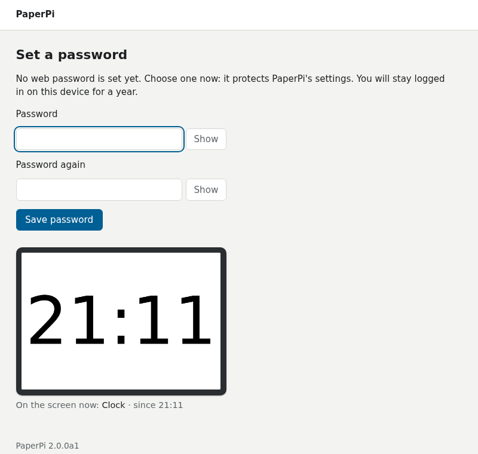
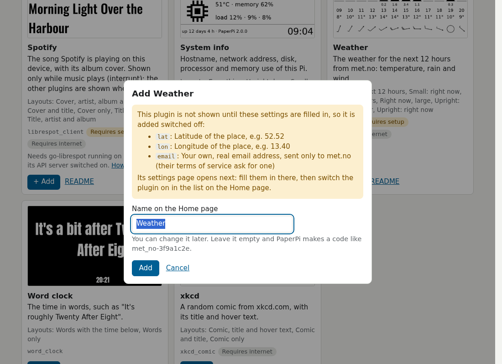
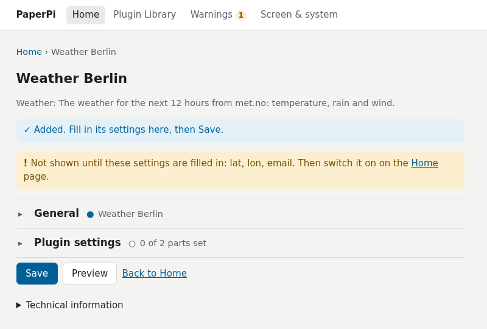
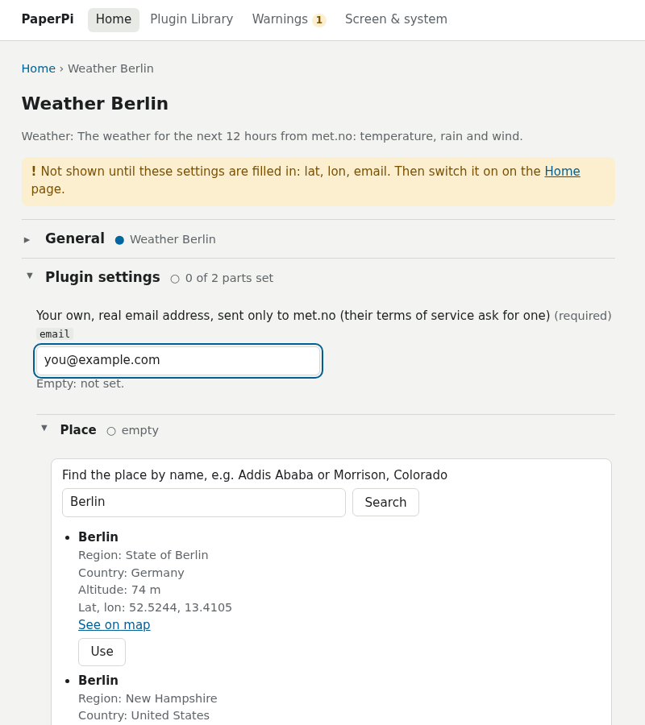
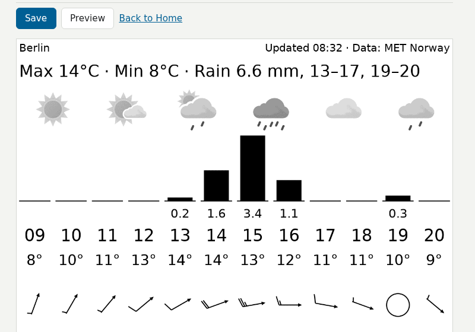
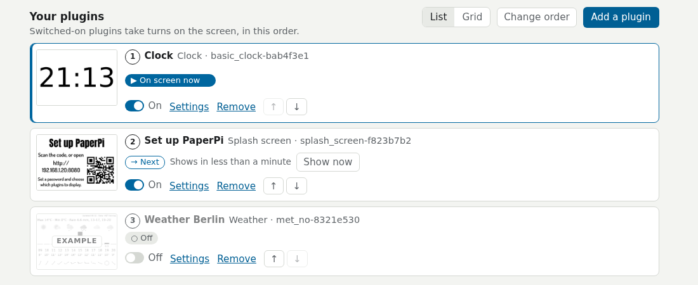

# First setup

After the [install](install.md), you set PaperPi up in its web interface: a web page on your phone or computer. This page goes through the first visit, step by step. What every page of the web interface does: [The web interface](web-interface.md).

## 1. Open the web interface

Scan the QR code on the screen, or type the address it shows (such as `http://192.168.1.20:8080`) into a browser on a phone or computer on the same home network. The address is the Pi's address on your network, then `:8080`. Your router's list of devices shows the Pi's address too, and on the Pi `hostname -I` prints it.

Names such as `paperpi.local` don't work for now; use the numbers.

## 2. Set a password

The first page asks for a password, at least 8 characters. It protects PaperPi's settings: anyone on your home network can open the web interface, and until a password is set, anyone there can set it. The browser stays logged in for a year.

Forgot the password later? See [Forgotten password](web-interface.md#forgotten-password).

## 3. The Home page

Home shows the picture on the screen now and **Your plugins**: the plugins that take turns on the screen, in this order. A new install has two:

- **Clock**: the time, in large numbers.
- **Set up PaperPi**: the set-up screen with the QR code. Remove it once PaperPi is set up (**Remove** on its card), or switch it off.

Each card has a switch (**On** or **Off**), **Settings**, **Remove**, and arrows to move it up or down in the order.

## 4. Add a plugin

1. Open the **Plugin Library** (in the menu at the top, or **Add a plugin** on Home). It has a card for every plugin that comes with PaperPi, with an example picture drawn at your screen's size. "Requires setup" means the plugin needs some settings before it can show anything, such as a place or a login.

    

2. Press **+ Add** on a plugin's card, give it a name for the Home page (for example "Weather Berlin"), and press **Add**. You can add the same plugin more than once, for example the weather for two places.

    

A plugin that needs no settings is added switched on, at the end of the list. A plugin that needs settings is added switched off, and its Settings page opens.

## 5. Fill in its settings

The Settings page says which settings are still missing. The settings are in sections that open and close: **General** (the name, how long it stays on the screen, how often it gets new data, its layout) and **Plugin settings** (what only this plugin has).

For the weather, open **Plugin settings**:

1. Fill in **email**: your own, real email address. met.no, the weather service, asks every program for one; PaperPi sends it only to them.
2. Open **Place**, type the place's name into the search box, press **Search**, and press **Use** under the right one. That fills in its latitude, longitude, altitude and name.

**Preview** draws the plugin with the settings in the form, at your screen's size, without saving them and without touching the screen. If the real data can't be fetched yet, it draws sample data and says why.

Press **Save**. The change applies at once; there is no need to restart PaperPi. Every setting of every plugin, with its help text: the plugin's own page under [Plugins](plugins/index.md).

## 6. Switch it on

Back on **Home**, switch the new plugin **On**. Its card shows **Configuration Required** while a required setting is still missing; then the switch can't be used.

Use the arrows to change the order, or **Change order** to drag the cards. **Show now** on a card puts that plugin on the screen right away.

## 7. Check the screen settings

If you chose `0` (no screen yet) during the install, or the picture looks wrong, open **Screen & system** in the menu. **Change screen…** sets the kind of screen and its model; [The web interface](web-interface.md#screen-system) has the details.

That's it: PaperPi now shows your plugins in turn. To keep it up to date: [Update and remove](update.md).
