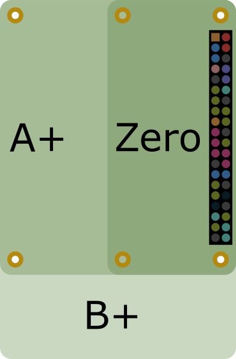
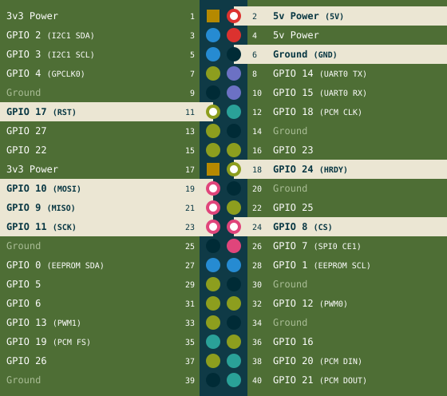
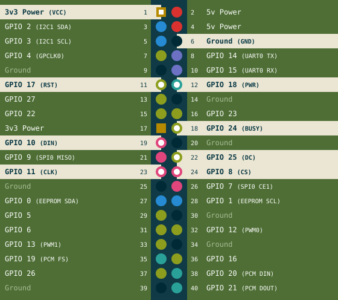

# Hardware

Basic requirements and connection

## Required Hardware

- **A Raspberry Pi 3 or 4.** Other models, such as the Pi 5, have not been tried yet.
- **A power supply** made for your Pi: the official one is the safe choice (5.1 V, 2.5 A for a Pi 3; 5.1 V, 3 A with USB-C for a Pi 4). A weak supply can make the Pi restart while the screen draws.
- **An SD card** of 8 GB or more, with **Raspberry Pi OS "Trixie" or "Trixie Lite" (recommended)**. [Raspberry Pi Imager](https://www.raspberrypi.com/software/) writes it to the card. In its settings, set the Wi-Fi network, a user name and password, and switch on SSH (logging in to the Pi from another computer), so you can install PaperPi without a keyboard and screen on the Pi.
- **Supported e-paper screen** [Supported screens](screens.md)
    - **A screen with Waveshare's IT8951 board**, such as the Waveshare 9.7", 6", 7.8", 10.3" or 13.3" for 16-level gray
    - **One of Waveshare's small screens on their e-Paper HAT** (a board that sits on the Pi's pins), from 1.02" to 13.3": black and white, gray, full color. Three-color screens show only black and white for now (epdlib issue [#96](https://github.com/txoof/epdlib/issues/96)).
- **Internet** for the Pi during the install, and for plugins that fetch data (weather, calendar, comics).

!!! note "Hot Plugging Screens is Dangerous!"
    Connect or disconnect the screen only while the Pi is off and its power cable is out. Plugging a board onto the pins of a running Pi can damage both the Pi and the driver board.

## GPIO Pin Orientation Reference

- **Pin 2** on the GPIO header is located at the corner *furthest* from the network port
- **Pin 1** on the GPIO header (square pad) is located directly to the left of pin 2 in the diagram

{ width="180" }

## IT8951 board Pin Out

1. If the board has a switch for the kind of connection, set it to **SPI**. Check the Waveshare documentation for your board.
2. Connect the screen's flat ribbon cable to the IT8951 board: open the connector's lock, slide the cable in as far as it goes, and close the lock.
3. Connect the board to the Pi: plug it straight onto the Pi's 40 pins, or use jumper wires (single wires with a plug at each end), pin by pin as in the picture below.
4. Write down the **VCOM** number printed on the screen's ribbon cable, for example `-1.90`. Each screen has its own and needs to be set during install.

!!! note "Use the printed VCOM Value"
    Use the number printed on your screen's cable. A different value can give a faded picture or ghosting (traces of the previous picture).

| Board pin | Pi pin       | Function                              |
| --------- | ------------ | ------------------------------------- |
| 5V        | 2            | power 5 V                             |
| GND       | 6            | ground                                |
| MISO      | 21 (GPIO 9)  | data from the screen (SPI)            |
| MOSI      | 19 (GPIO 10) | data to the screen (SPI)              |
| SCK       | 23 (GPIO 11) | the SPI clock                         |
| CS        | 24 (GPIO 8)  | chip select: "this data is for you"   |
| RST       | 11 (GPIO 17) | reset                                 |
| HRDY      | 18 (GPIO 24) | busy: the board says when it is ready |

The IT8951 board leaves the other pins free, so a HiFiBerry sound card can be used on the same Pi.

## Typical Non IT8951 Pin Out

1. Connect the screen's ribbon cable to the HAT.
2. Set the HAT's two small switches: **Display Config** to **B** for most screens and **Interface Config** to **0**. Check the Waveshare documentation for your board.
3. Plug the HAT onto the Pi's 40 pins, or use jumper wires, pin by pin as in the picture below.

More about these screens, such as which are tested: [Supported screens](screens.md#waveshare).

| HAT pin | Pi pin       | Function                                      |
| ------- | ------------ | --------------------------------------------- |
| VCC     | 1            | power, 3.3 V                                  |
| GND     | 6            | ground                                        |
| DIN     | 19 (GPIO 10) | data to the screen (SPI)                      |
| CLK     | 23 (GPIO 11) | the SPI clock                                 |
| CS      | 24 (GPIO 8)  | chip select: "this data is for you"           |
| DC      | 22 (GPIO 25) | data or command                               |
| RST     | 11 (GPIO 17) | reset                                         |
| BUSY    | 18 (GPIO 24) | busy: the screen says when it is ready        |
| PWR     | 12 (GPIO 18) | switches the screen's power (newer HATs only) |

!!! note "GPIO 18 is also used by HiFiBerry sound cards"
    PaperPi uses GPIO 18 for every screen on the e-Paper HAT, so the e-Paper HAT and a HiFiBerry sound card can't be used on the same Pi for the moment. This is an open issue at [epdlib](https://github.com/txoof/epdlib/issues/109).

Next: [Install](install.md).

---

<small>The pin pictures follow the layout of [pinout.xyz](https://pinout.xyz), and the picture of the Pi is pinout.xyz's, under the [CC BY-SA 4.0](https://creativecommons.org/licenses/by-sa/4.0/) license.</small>
