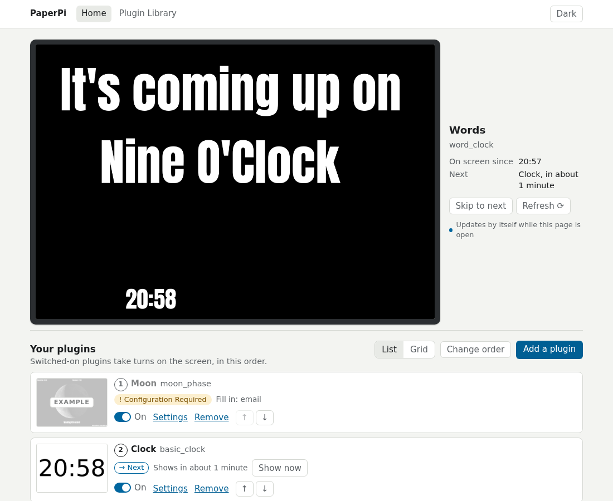

# PaperPi

PaperPi is a lovely, quiet, slow internet e-Paper radio. No loud colors, no busy animations, just a lovely selection of the information you want without buzz and distraction. PaperPi rotates through your choice of plugin screens at the pace you choose.



## Install

PaperPi runs great on a Raspberry Pi 3 or better!

Minimum requirements:

- Pi 3 or better with Raspberry Pi OS Trixie
- E-Paper screen - nearly all of Waveshare's screens work and many have been tested

Optional:

- Internet connectivity for some plugins

### Quick Start

One command on the Pi installs PaperPi and starts it with prompts to guide you through the install.

```bash
curl -fsSL https://raw.githubusercontent.com/txoof/PaperPi/main/install/paperpi-install | sudo bash
```

Then open the web interface at the address the screen shows: [First setup](first-setup.md).

## What's in this manual

**Get started**

- [Hardware](hardware.md): Parts, pins and connections
- [Install](install.md): Step by step build instructions
- [First Run](first-setup.md): Setting a password and configuring plugins
- [Web Interface](web-interface.md): Getting around the interface
- [Update and Uninstall](update.md): Updating, rolling back and uninstalling PaperPi
- [Understanding Plugin Schedules](take-turns.md): Display time, refresh, and the levels rotation, interrupt and alert
- [Troubleshooting](troubleshooting.md): Basic troubleshooting steps
- [What's New](changelog.md): Changelog!

**Reference**

- [Plugins](plugins/index.md): Gallery of the plugins and their settings
- [Settings reference](settings.md): Config file reference
- [Supported screens](screens.md): Complete list of Waveshare Screens and known issues
- [How the service works](install-systemd.md): where the files are, the commands to check on PaperPi, and how systemd keeps it running

**For developers**

- [Running from source](development.md), [Writing plugins](writing-plugins.md), [Making a release](releasing.md).

## Version 1

This manual is for PaperPi version 2, a rewrite from scratch. **Version 1 is no longer maintained:** and is no longer supported. Version 2 does not read V1 config files. V1 code remains on the [`v1` branch](https://github.com/txoof/PaperPi/tree/v1), with the last state marked by the tag [`v1-final`](https://github.com/txoof/PaperPi/tree/v1-final).

## Help and source code

PaperPi is free software (GPL 3.0 or later). The code, and the place to report problems, is [txoof/PaperPi on GitHub](https://github.com/txoof/PaperPi). The screens are driven by [epdlib](https://github.com/txoof/epdlib), a separate library on [PyPI](https://pypi.org/project/epdlib/).
