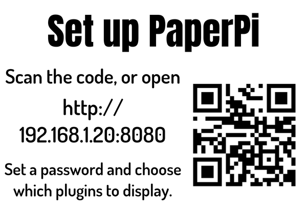

# Install

Before you start: the screen is connected ([Hardware](hardware.md)), the Pi runs Raspberry Pi OS "trixie" and is on your home network.

## Run the install

1. Log in to the Pi: with a keyboard and screen on the Pi, or from another computer with SSH (`ssh <user>@<the Pi's name or address>`).
2. Run this command. It downloads PaperPi's install script and runs it with `sudo` (as administrator, so it can install programs):

    ```bash
    curl -fsSL https://raw.githubusercontent.com/txoof/PaperPi/main/install/paperpi-install | sudo bash
    ```

3. Answer its questions. Type the number of your answer and press Enter; `b` goes back to the question before.
    1. **Which screen is connected?** `1` for a screen with the IT8951 board, `2` for a small screen on the e-Paper HAT, `0` if none is connected yet (you choose it later in the web interface).
    2. **Which size?** The size in inches, as on the box. For a small screen, the menu uses Waveshare's way of writing it: `7in5` is 7.5 inch.
    3. For a small screen: **which model** of that size, such as `7in5_V2`. The version ("V2") is on the screen's box or the sticker on its back. The tested models come first.
    4. For an IT8951 screen: **the vcom**, the number printed on the screen's ribbon cable, for example `-1.90`.
    5. **Install what is missing?** The install needs a few programs from Raspberry Pi OS (`git`, `python3-venv`, `gcc`, `python3-dev`). Press Enter to install them.
4. Wait. The install switches on SPI (the data line to the screen), installs PaperPi and starts it; this takes a few minutes on a Pi 3. If SPI needs a restart of the Pi to work, the install asks first and PaperPi starts by itself after the restart.

## What the screen shows

For the first minute, PaperPi's name, version and the address of its web interface. Then a clock and this set-up screen take turns:



Scan the QR code with your phone's camera, or type the address into a browser on a phone or computer on the same home network. Then go on with [First Setup](first-setup.md).

The screen stays blank or shows nothing new? Check that PaperPi runs: `systemctl status paperpi` should say `active (running)`. The log of the last minutes: `journalctl -u paperpi -n 50`.

## Install without questions

To install from another script, download the install script and give the answers as options. `--yes` asks nothing and uses no screen (the virtual screen, which only saves pictures) unless `--display` names one:

```bash
curl -fsSLO https://raw.githubusercontent.com/txoof/PaperPi/main/install/paperpi-install
sudo bash paperpi-install install --yes --display it8951 --model 9.7 --vcom -1.90
sudo bash paperpi-install install --yes --display waveshare --model epd7in5_V2
```

`sudo bash paperpi-install --help` lists every option. The model names of the small screens are on [Supported screens](screens.md#waveshare).

## Already installed?

The install keeps a config that is already there (in `/etc/paperpi`, from an earlier install) and asks nothing about the screen. To update PaperPi, use [Update and Uninstall](update.md). What the install puts where: [How the service works](install-systemd.md).
