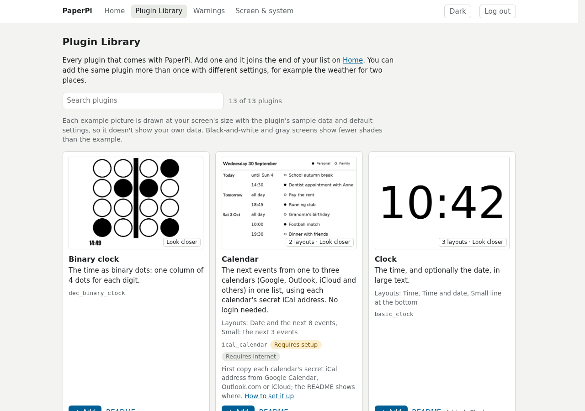
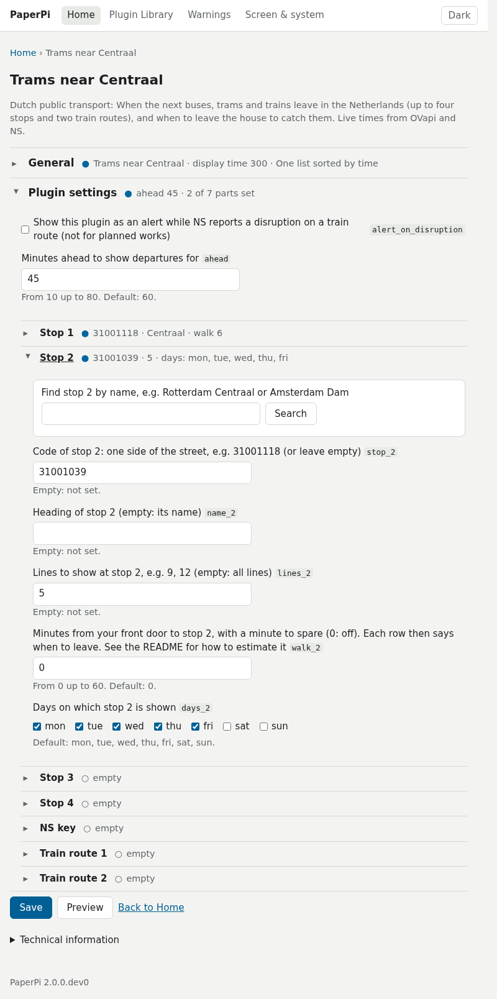
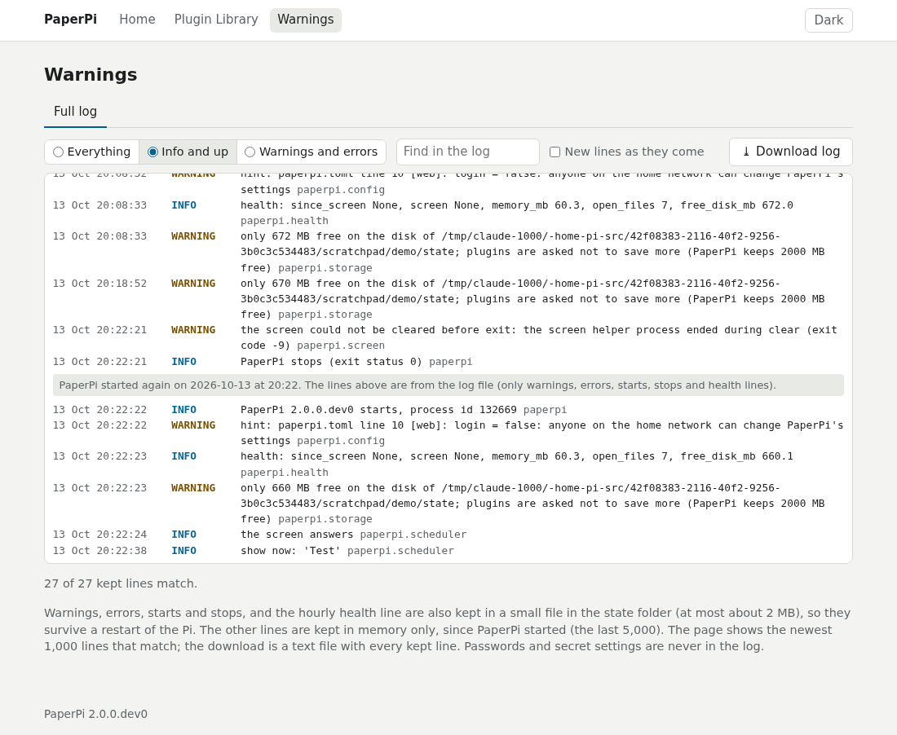
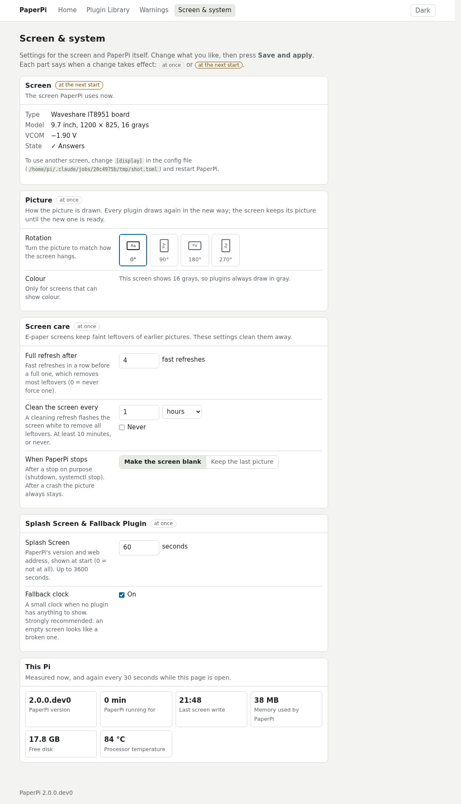
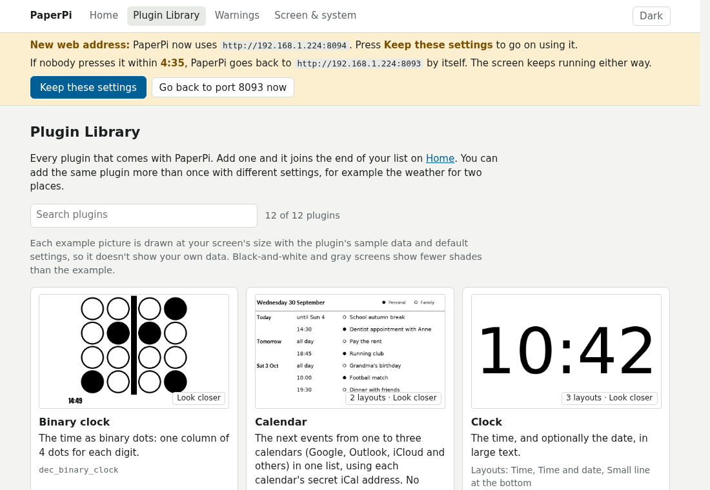
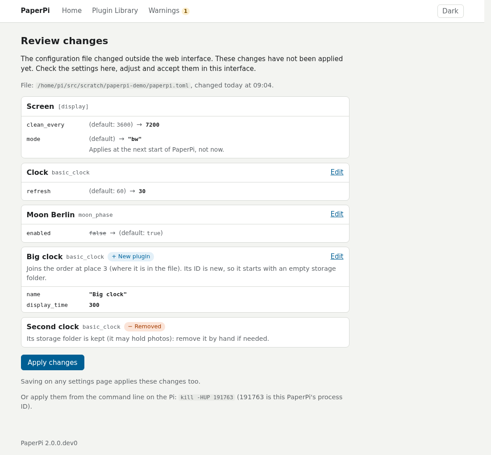

# The web interface

PaperPi is set up in a web page, on any phone or computer on your home network. Open it at the address the screen shows at start, for example `http://192.168.1.20:8080` (the Pi's address, then `:8080`; on the Pi, `hostname -I` prints the address). The first visit: [First setup](first-setup.md).

Every page has a menu at the top (on a phone: one **☰ Menu** button) and a **Dark**/**Light** button; otherwise the pages follow your device's light or dark setting. A change applies at once and is saved in the config file, `/etc/paperpi/paperpi.toml`.

## Home

- **At the top:** the picture on the screen now. It updates by itself while the page is open. Next to it: which plugin it is, which one comes next, and the buttons **Skip to next**, **Refresh** (get new data and draw again) and, while an alert is shown, **Dismiss alert**.
- **Your plugins:** a card for each plugin, in the order they take turns, as a **List** or a **Grid**. Each card has the plugin's latest picture and its state (on screen now, next, waiting, paused after errors), and:
    - **Show now**: put it on the screen right away.
    - the switch: **On** or **Off**. A plugin with a required setting missing shows **Configuration Required** and can't be switched on yet.
    - **Settings**, **Remove**, and arrows to move it up or down. **Change order** lets you drag the cards instead.

## Plugin Library

A card for every plugin that comes with PaperPi: its name, what it shows, labels such as "Requires setup" and "Requires internet", the names you already added it under, a link to its **README** (its instructions), and an example picture drawn at your screen's size from the plugin's sample data. The search box finds plugins by name or description.

The example pictures are drawn in the background: they start a minute after PaperPi starts, or when you open the page; until then the page says "Drawing the example picture…". Click a plugin's name or picture for **Look closer**: a bigger picture of each of its layouts.

**+ Add** adds a plugin at the end of the list. A plugin that needs settings (such as the weather, which needs a place and your email address) is added switched off, and its Settings page opens to fill them in.

## Settings of a plugin

Every setting of the plugin, with its help text and its default, in sections that open and close: **General** (name, display time, refresh, layout, level) and the plugin's own settings. A mistake is shown next to its field, and nothing is saved until it is fixed. Some settings have a search box that fills them in, such as a place for the weather or a stop for public transport.

**Preview** draws the plugin with the settings in the form, before you save them, at your screen's size, without touching the screen. If the real data can't be drawn, it shows sample data and says why. **Save** saves and applies the settings.

What each setting means: the plugin's page under [Plugins](plugins/index.md), and the settings every plugin has: [Settings reference](settings.md).

## Warnings

What needs attention now, each with a button that helps: a paused plugin, missing settings, a mistake in the config file, a screen that does not answer. Below that, the last 100 warnings and errors. The menu entry shows how many things need attention.

Its **Full log** tab has more: every line of PaperPi's log since the start (the last 5,000), after the lines kept from before the start, with a level filter, a search box, new lines as they come, and **Download log**. Warnings, errors, starts, stops and crashes are also kept in a file (`/var/lib/paperpi/paperpi.log`, at most about 2 MB), so they are still there after a restart of the Pi.

## Screen & system

The settings of the whole of PaperPi, in sections. Each section says when a change applies: **at once**, or **at the next start**. **Save and apply** saves them; leaving the page with changes not saved asks first.

- **Screen:** the screen PaperPi uses, and whether it answers. **Change screen…** chooses another screen, or a new VCOM for this one. A new screen needs a restart of PaperPi; the page offers it. If the new screen does not answer, the page offers to go back to the old one.
- **Picture:** turn the picture to match how the screen hangs (0°, 90°, 180°, 270°), and colour on or off for a colour screen.
- **Screen care:** e-paper screens keep faint leftovers of earlier pictures. **Full refresh after** a number of fast refreshes, and **Clean the screen every** so many minutes or hours, remove them. Screens without fast refreshes don't need this. **When PaperPi stops:** a blank screen or keep the picture.
- **Splash Screen & Fallback Plugin:** how long PaperPi's name and web address are shown at start (0: not at all), and the **Fallback clock**: a small clock when no plugin has anything to show (for example no music is playing), so you can tell the screen still works.
- **Web interface:** the **Port** (the number after the colon in the address), who can reach it (**Reachable from**: every device on your home network, or only this Pi), **Ask for a password**, and **Change password…**. A new port is tried before it is saved.
- **This Pi:** PaperPi's version, how long it has been running, the last screen write, its memory use, the free disk and the processor's temperature, with **Restart PaperPi**.

**After changing the port or address**, PaperPi restarts, and every page asks you to press **Keep these settings** within 5 minutes. If nobody does, or the new port can't be used, PaperPi goes back to the old address by itself, and the Warnings page says so.

## Password and logging in

- **First visit:** the first person to open the web interface sets the password (at least 8 characters). The browser then stays logged in for a year, until **Log out**. Log out only logs out that browser; a new password logs out every browser.
- **No password at all:** switch off **Ask for a password** on Screen & system. Then anyone on your home network can change PaperPi's settings; the Home page says so.

### Forgotten password

You need access to the Pi itself (a keyboard and screen, or SSH).

1. Run `sudo paperpi reset-password`. It removes the password from the config file and leaves the rest of the file as it is.
2. Run `sudo paperpi reload`, so PaperPi reads the config file again.
3. Open the web interface and set a new password. Until then, anyone on your home network can set it.

### Can't reach it after changing the port or address

On the Pi, run `sudo paperpi web-defaults`, then `sudo systemctl restart paperpi`. PaperPi then uses port 8080 again, for every device on your home network.

## Editing the config file by hand

The web interface and the config file can be used together. After you change `/etc/paperpi/paperpi.toml` by hand, a bar on every page says that PaperPi does not use the changes yet. Its **Review changes** page lists them (old and new value, per plugin) and has:

- **Apply changes**: PaperPi uses the edited file (the same as `sudo paperpi reload` on the Pi). A file with a mistake is not used: the page shows the mistake and its line, and the old settings keep running.
- **Undo hand edits**: puts back the file PaperPi uses, and keeps your edited file as `paperpi.toml.undone` next to it.

Comments in the file stay when the web interface changes it, except the comments of a plugin you remove, and a comment at the end of a line whose setting the web interface changes. If the file changed since the page was opened, or is written in a way the web interface can't change safely, nothing is saved and the page says so.

## Safety

- The web interface uses plain HTTP, not HTTPS: it is for your home network only. **Do not open it to the internet** (for example with port forwarding on your router).
- Names such as `paperpi.local` are refused for now, for safety; use the Pi's address in numbers ([why](decisions/web-interface.md)).
- If the port is taken by another program, the log says so and PaperPi runs without the web interface.
