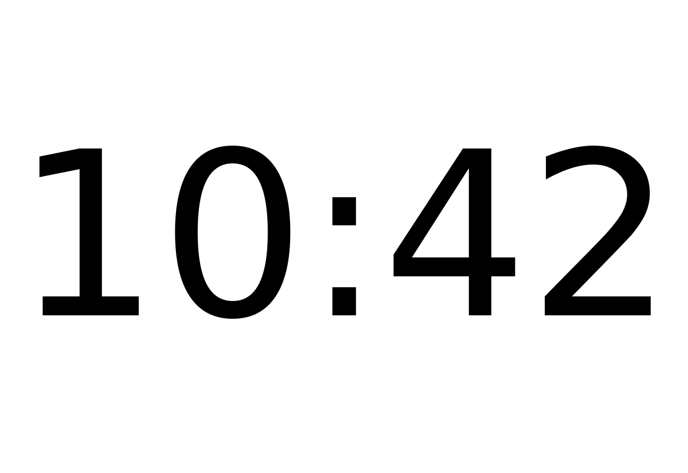
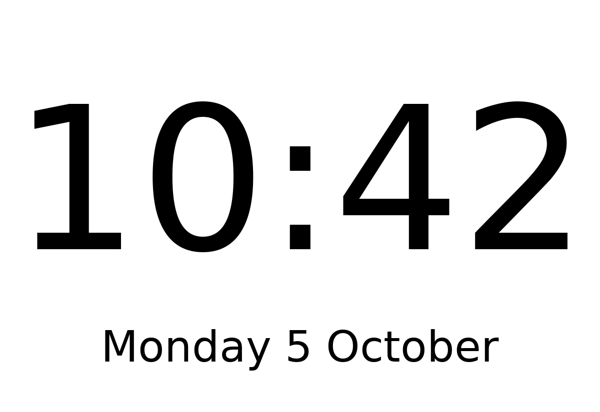

# basic_clock

Shows the time in large digits, and optionally the date below it.

This plugin takes its turn with the other plugins using the `rotation` display level. It needs no network and no setup.



## Set it up

1. In the PaperPi web interface, open the **Plugin Library** and add **Clock**.
2. Optionally, set `hours` to `12` and choose the `time_date` layout on its settings page.
3. Save.

## Layouts

| Layout           | Shows                                                                  |
| ---------------- | ---------------------------------------------------------------------- |
| `time` (default) | the time only, as large as fits                                        |
| `time_date`      | the time, with the date below it ("Monday 5 October")                   |
| `small`          | time and date on one small line at the bottom; the rest stays white   |

| `time` | `time_date` | `small` |
|---|---|---|
|  |  |  |

Note: PaperPi uses the `small` layout as its fallback clock when no plugin has anything to show ([Understanding Plugin Schedules](https://txoof.github.io/PaperPi/take-turns/)).

## Settings

| Setting | Default | Meaning                                |
| ------- | ------- | -------------------------------------- |
| `hours` | `24`    | `24` shows 15:45, `12` shows 3:45 PM   |

The plugin asks for a new picture every 60 seconds, just after the minute changes, unless you change `refresh`.

### Configuration Keys

```toml
[[plugin]]
id = "basic_clock-b0ec65a0"
name = "Clock"
type = "basic_clock"
layout = "time_date"
hours = 12
```

## For developers

Try it without a screen: `uv run paperpi render basic_clock --layout time_date --set hours=12`. The sample time is 10:42 on Monday 5 October 2026.
