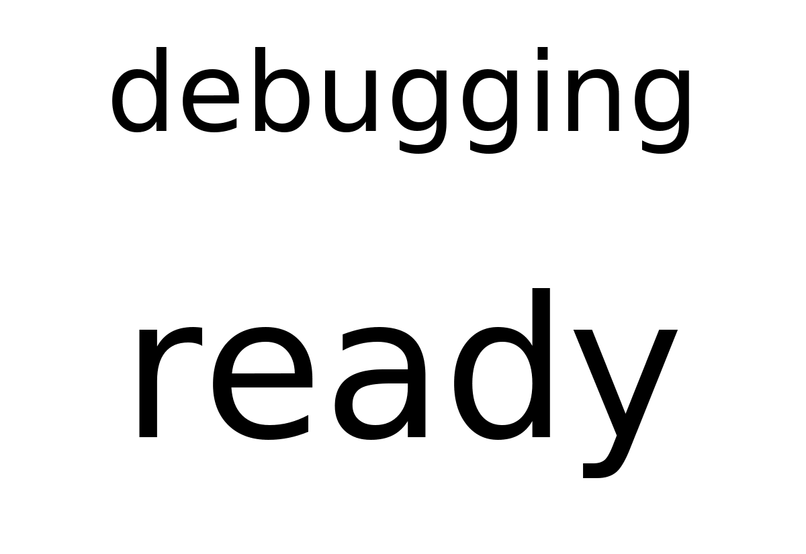

# debugging

A plugin for testing PaperPi itself: it can crash, hang, and switch between the states "nothing", "ready" and "alert" in a fixed pattern.

It is not in the Plugin Library; add it in the config file. It needs no network.



## Set it up

1. Add a `[[plugin]]` block with `type = "debugging"` to the config file (see [Configuration Keys](#configuration-keys)).
2. Set `states`, `crash_every`, `hang_every` and `delay` to the pattern you want to test.
3. Restart PaperPi, or use the web interface's **Review changes** page.

## How it works

Every update adds 1 to a count, and the count decides what the update does, so the same settings always give the same pattern.

Note: the picture shows nothing else, no time or count, so two updates with the same state give the same picture and the screen is not written again.

## Layouts

| Layout                 | Shows                                     |
| ---------------------- | ----------------------------------------- |
| `text_state` (default) | `text` above the state ("ready", "alert") |

## Settings

| Setting       | Default       | Meaning                                                                    |
| ------------- | ------------- | -------------------------------------------------------------------------- |
| `text`        | `"debugging"` | text shown above the state, e.g. to tell several debugging plugins apart   |
| `states`      | `["ready"]`   | states to report, one per update, then from the start                      |
| `crash_every` | `0`           | every Nth update raises an error; `0` = never                              |
| `hang_every`  | `0`           | every Nth update hangs until its time limit stops it; `0` = never          |
| `delay`       | `0`           | seconds each update takes, like a slow web request                         |

The plugin asks for a new picture every 30 seconds unless you change `refresh`.

### Configuration Keys

An alert every 3rd update, and a crash every 5th:

```toml
[[plugin]]
id = "debugging-5d5b3b43"
name = "Test alert"
type = "debugging"
level = "alert"
text = "test alert"
states = ["nothing", "nothing", "alert"]
crash_every = 5
refresh = 20
```

## For developers

The count is kept in the file `count` in the plugin's storage folder: `plugins/<folder>/` in PaperPi's state folder (`/var/lib/paperpi` unless `paperpi run --state-dir` says otherwise). The folder name is made from the plugin's `id`: lowercase, with `-` for `_`, e.g. `debugging-5d5b3b43`.

Draw its sample picture: `uv run paperpi render debugging`. To see the pattern, use `paperpi run` (see [Running from source](https://txoof.github.io/PaperPi/development/#run-paperpi)): `render` starts with a new, empty storage folder each time, so its count is always 1.
