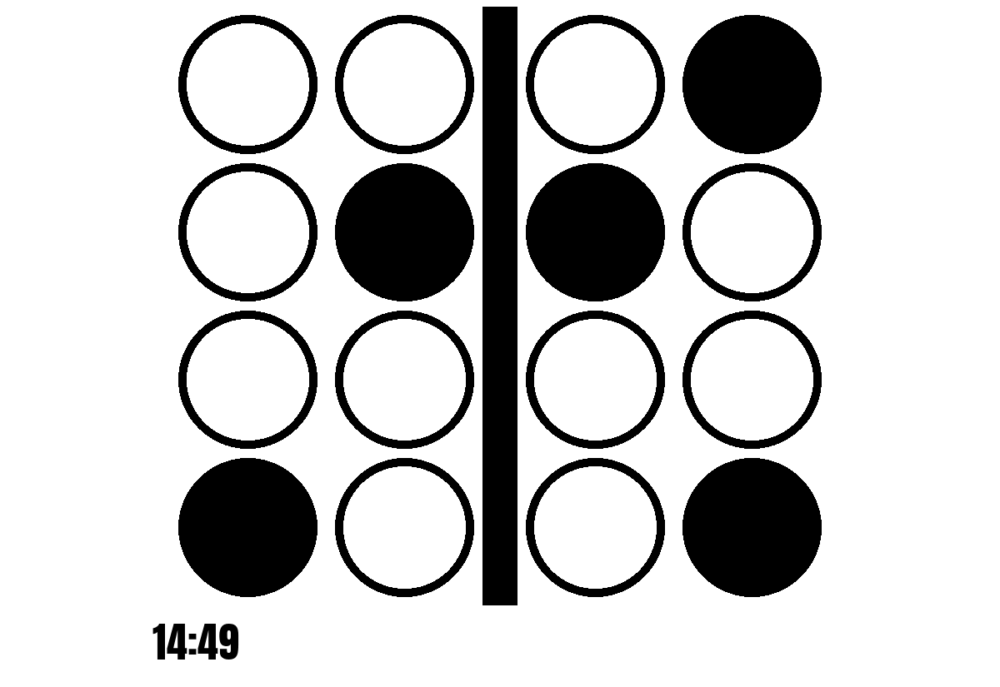
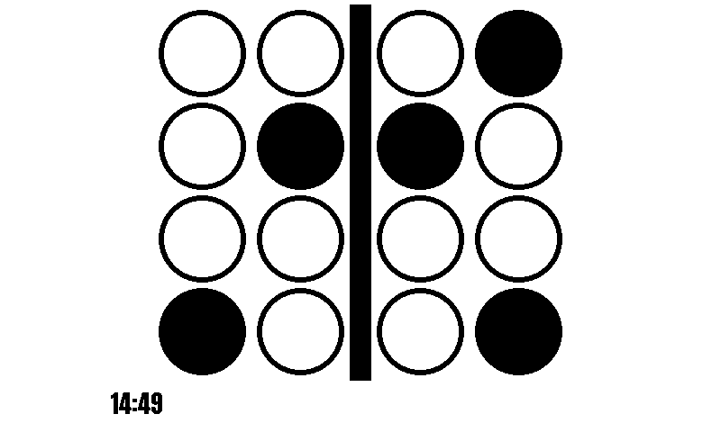
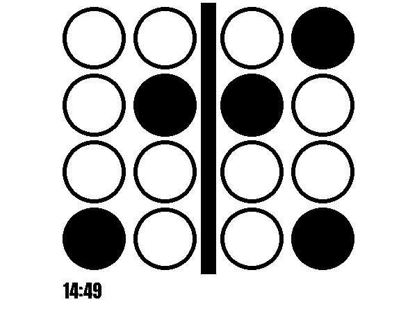

# dec_binary_clock

Shows the time as binary dots, with the time in digits small underneath.

This plugin takes its turn with the other plugins using the `rotation` display level. It needs no network and no setup.



## Set it up

1. In the PaperPi web interface, open the **Plugin Library** and add **Binary clock**.
2. Save.

## How to read it

There is one column of 4 dots for each digit of the 24-hour time: tens of the hour, ones of the hour, a bar (the colon), tens of the minute, ones of the minute. From top to bottom the dots of a column are worth 8, 4, 2 and 1. Add up the filled dots of a column to get the digit; rings don't count.

For 14:49:

```
 .  .  |  .  #     8
 .  #  |  #  .     4
 .  .  |  .  .     2
 #  .  |  .  #     1
 1  4     4  9
```

(`#` filled, `.` ring.)

## Layouts

| Layout                | Shows                                                                 |
| --------------------- | --------------------------------------------------------------------- |
| `dots_time` (default) | the dots, as large as fits, with the time in digits underneath        |

| 9.7" | 7.5" black and white | 5.65" color |
|---|---|---|
|  |  |  |

Note: the digits underneath move left and right at every update, as in v1.

## Settings

None of its own, only the [settings every plugin has](https://txoof.github.io/PaperPi/settings/#settings-every-plugin-has).

The plugin asks for a new picture every 60 seconds, just after the minute changes, unless you change `refresh`.

### Configuration Keys

```toml
[[plugin]]
id = "dec_binary_clock-f4cf009c"
name = "Binary Clock"
type = "dec_binary_clock"
```

## For developers

Every column has 4 dots, also those that never need all of them: the tens of the hour (0-2) never use the 8 and 4 dots, the tens of the minute (0-5) never use the 8 dot.

Try it without a screen: `uv run paperpi render dec_binary_clock --size 800x480 --mode bw`. The sample time is 14:49 on Monday 5 October 2026. The font is [Anton](https://fonts.google.com/specimen/Anton), under the SIL Open Font License ([`fonts/Anton-OFL.txt`](../../fonts/Anton-OFL.txt)).
