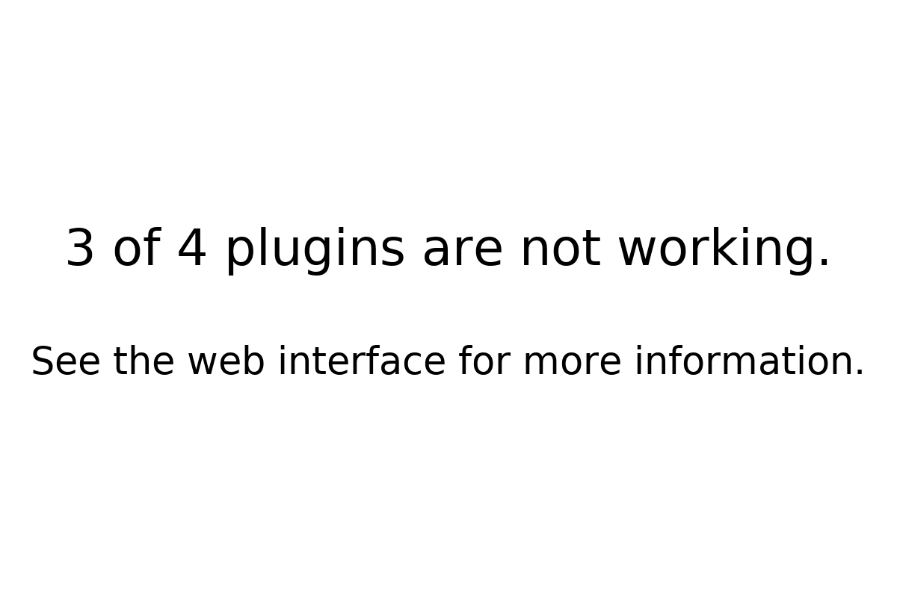

# default

Shows how many plugins are not working, and where to look, when nothing else can be shown.

PaperPi always has this plugin; it is not in the Plugin Library and never takes part in the rotation. It needs no network and no setup.

## When it is shown

PaperPi shows it when plugins are failing, or when no plugin is ready to show and the [splash screen](../splash_screen/README.md) (which normally shows then) fails. It says, for example, "3 of 4 plugins are not working. See the web interface for more information."

Note: to find out what is wrong, open the web interface's Warnings page ([Troubleshooting](https://txoof.github.io/PaperPi/troubleshooting/)).

## Layouts

| Layout              | Shows                                               |
| ------------------- | --------------------------------------------------- |
| `message` (default) | how many plugins are not working, and where to look |

## Settings

None of its own. A `[[plugin]]` block with `type = "default"` in the config file changes its [settings every plugin has](https://txoof.github.io/PaperPi/settings/#settings-every-plugin-has).

## For developers

The scheduler tells the plugin how many plugins are not working. A plugin is ready to show when it is switched on and all its required settings are filled in. The sample is 3 of 4 plugins not working.
