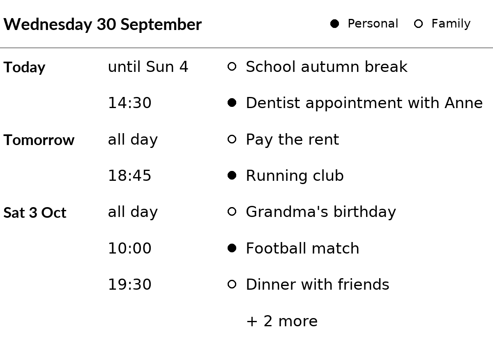
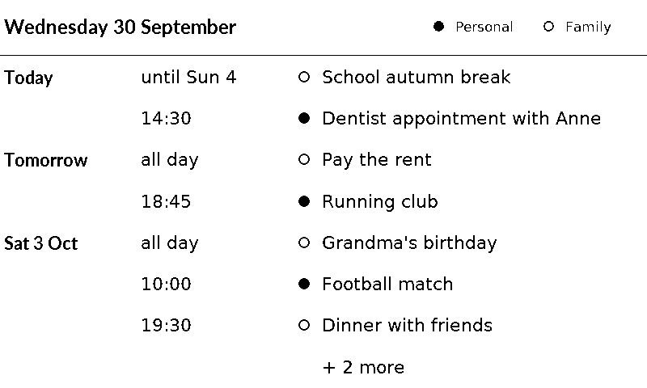
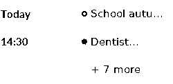

# ical_calendar

The next events from one, two or three calendars, merged into one list sorted by time: today's date at the top, then one row per event with its day, its time and its title. Each day is named once ("Today", "Tomorrow", "Sat 3 Oct"); all-day events come first on their day.

With two or three calendars, each event has its calendar's mark before the title: a filled circle for `calendar_1`, an open circle for `calendar_2`, a filled square for `calendar_3`. The marks are small pictures, all the same size. The top right shows each mark with the calendar's name ("Personal", "Family"), from the settings `name_1` to `name_3` ("Calendar 1" when a name is not set). With one calendar there are no marks.

It works with any calendar that gives an iCal address (iCal is the standard file format for calendars, ending in `.ics`): Google Calendar, Outlook.com, iCloud, Nextcloud, Fastmail and others. No login is needed.

## Getting the address

Each calendar has a **secret address**: a web address that gives its events to anyone who has it, without a login. Treat it like a password.

In **Google Calendar** (on a computer, at calendar.google.com):

1. Click the gear icon at the top right, then **Settings**.
2. On the left, under "Settings for my calendars", click the calendar.
3. Scroll to **Integrate calendar** and copy **Secret address in iCal format** (it ends in `/basic.ics`).

Only the owner of a calendar, and people who may "make changes and manage sharing", see this address. For a calendar someone else shared with you, ask them to give you that permission, or to copy the address for you. Work and school accounts may have it switched off by their administrator.

If the address ever gets out, click **Reset** next to it in the same place: the old address then stops working. Put the new one in the plugin's settings.

**Outlook.com:** Settings, Calendar, Shared calendars, Publish a calendar, choose "Can view all details", and copy the ICS link. **iCloud:** in the Calendar app, share the calendar as a public calendar and copy the address (it starts with `webcal://`, which the plugin accepts).

Why not a normal Google login? Google doesn't allow the "enter a code on your phone" login for calendars, and a home-made app that is still in Google's "testing" status loses its access every 7 days. The secret address avoids both.

## Updates and the saved events

The plugin downloads each calendar at every update. Google sends the whole calendar, back to its first event, so a calendar used for some years is about 1 MB, and reading it takes about 5 seconds on a Raspberry Pi 4. With three large calendars, an update may take 20 to 30 seconds (the time limit is 60 seconds); on a Pi 3, raise `time_limit` if updates are stopped.

It suggests a refresh every 30 minutes, so a new event can take up to half an hour to show.

After each download, the plugin saves that calendar's events of the coming days in its storage folder. When a calendar can't be downloaded, its saved events are shown instead, for up to one day; PaperPi's log says so. Saved events are not used for another address.

## Layouts

| Layout | Shows |
|---|---|
| `list` (default) | today's date and the calendars' marks and names, then the next 8 events: day, time and title |
| `small` | for tiny screens (2" to 3"): the next 3 events, with the day and time in one column ("18:45", "Thu 18:45"; 12-hour times are shortened to "6:45p"); the marks but not the names |

When there are more events than rows, the last row says how many more there are ("+ 3 more"). With no events: "Nothing planned for the next 7 days".

The time column shows:
- the start time ("14:30", or "2:30 PM" with `hours = 12`);
- "all day" for an all-day event;
- for an event that started on an earlier day and is still going: "until 10:00" (it ends today) or "until Sun 4"; for an all-day event "ends today" or "until Sun 4".

All text of a layout has one size, which depends on the size of the screen. A title that is too long is cut ("…"). Times are shown in the Pi's own time zone.

## Settings

| Setting | Default | Meaning |
|---|---|---|
| `calendar_1` | none, required | secret iCal address of a calendar, starting with `https://` or `webcal://` |
| `calendar_2` | none | address of a second calendar, shown in the same list |
| `calendar_3` | none | address of a third calendar, shown in the same list |
| `name_1`, `name_2`, `name_3` | `""` | short name of each calendar, shown next to its mark, e.g. `"Family"` (at most 20 characters) |
| `days` | `7` | how many days to show, starting today (1 to 31) |
| `hours` | `24` | `24` (15:45) or `12` (3:45 PM) |

The addresses are secret settings: the web interface shows them as password fields, and PaperPi never writes them in its log. Error messages name only the server ("calendar.google.com answered 404 Not Found"). A 404 usually means the address was reset.

In the config file (the rest of the file is shown in the main [README](../../../../README.md)):

```toml
[[plugin]]
id = "calendar"
name = "Calendar"
type = "ical_calendar"
calendar_1 = "https://calendar.google.com/calendar/ical/.../basic.ics"
calendar_2 = "https://calendar.google.com/calendar/ical/.../basic.ics"
name_1 = "Personal"
name_2 = "Family"
days = 5
```

Try it without a screen: `uv run paperpi render ical_calendar` (sample data), or with real data: `uv run paperpi render ical_calendar --live --set calendar_1=<address>`.

## Sample images

The sample data is made up: a week in Berlin from two calendars, "Personal" and "Family", on a Wednesday at 09:15, with an autumn break that started on Saturday. All sample images are in [`tests/images/`](../../../../tests/images/), named `ical_calendar-<layout>-<screen>.png`, where `<screen>` is `9in7` (9.7", 1200x825, 16 grays), `7in5` (7.5", 800x480, black and white) or `5in65` (5.65", 600x448, 7 colours).

| `list`, 9.7" | `list`, 7.5" | `small`, 2.13" (250x122) |
|---|---|---|
|  |  |  |

The `small` layout is also drawn on the usual three test screens, where it looks large.
