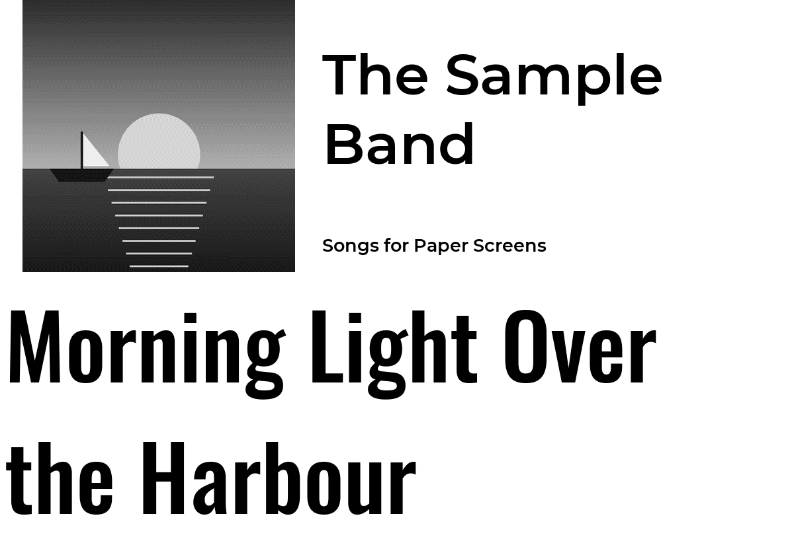
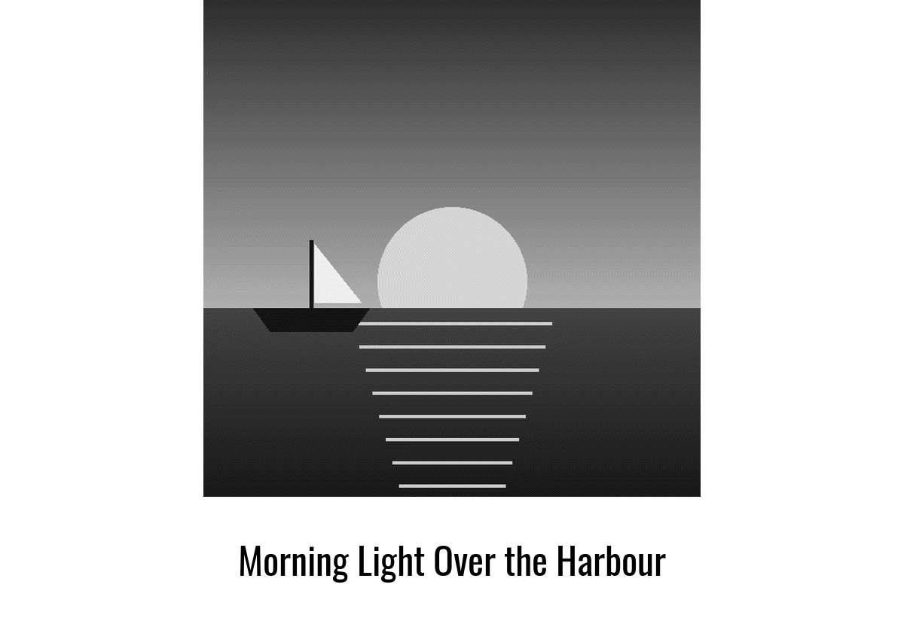
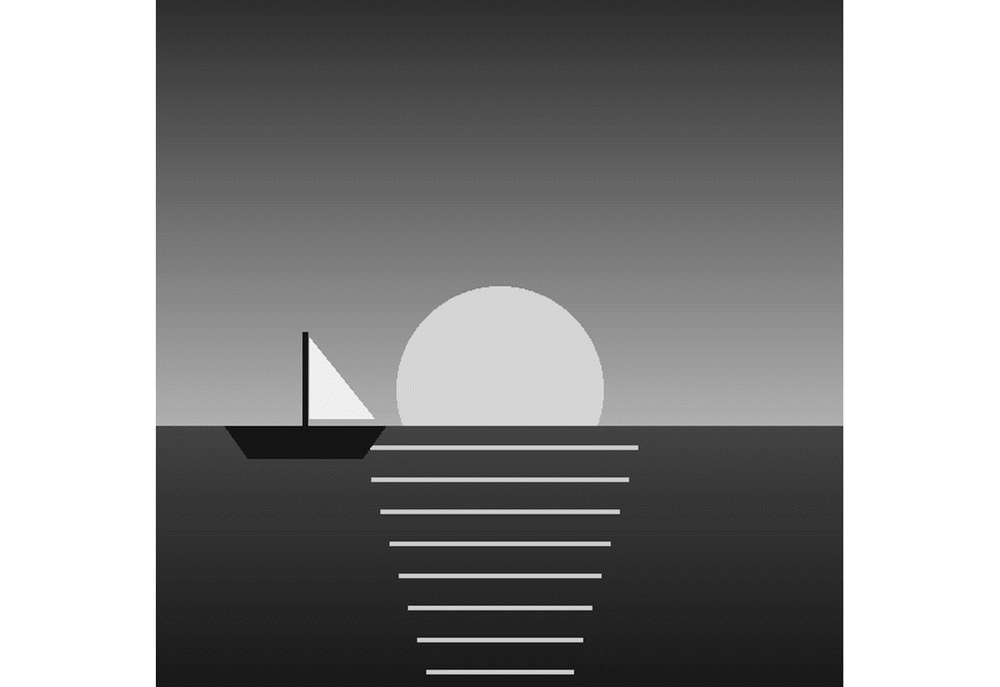
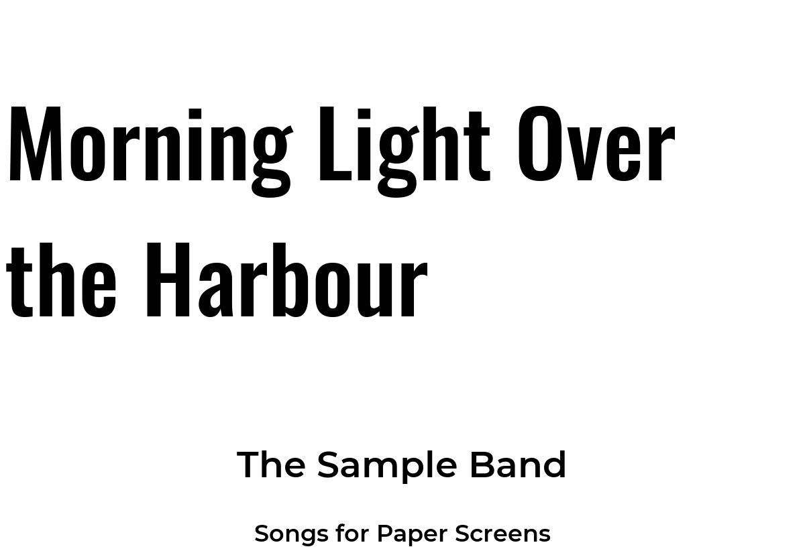

# librespot_client

The song Spotify is playing on this device: its title, artist, album and album cover. It works with [go-librespot](https://github.com/devgianlu/go-librespot), a program that makes the device a Spotify speaker: in the Spotify app, pick the device (go-librespot's `device_name`) as the speaker.

Use it with `level = "interrupt"`: while a song plays, it takes over the screen; when the music stops, the other plugins are shown again. A paused song stays on the screen for `idle_timeout` seconds (default 10), so a short pause doesn't change the screen.

At each update the plugin reads go-librespot's status (`http://localhost:<port>/status`). go-librespot's API server (the part that answers these questions) must be switched on in its `config.yml`:

```yaml
server:
  enabled: true
  port: 24879
```

Then restart go-librespot. The server only answers programs on the same device (unless its `address` says otherwise), so PaperPi and go-librespot must run on the same device.

The album cover is downloaded once (at most 2 MB, JPEG or PNG) and saved in the plugin's storage folder, so a song played again doesn't download it again. When the disk is nearly full, covers are not saved. A song without a usable cover is shown with a plain picture of a record. The plugin also saves a small file with the time the song was paused, because each update is a new program that can't remember it.

When go-librespot doesn't answer (not running, or the wrong port), the update fails, and PaperPi tries again at the next update. When nobody plays to it, the plugin has nothing to show, which is not a failure.

## Layouts

| Layout | Shows |
|---|---|
| `two_column_three_row` (default) | the cover with the artist and album next to it, the title below |
| `album_art_title` | a large cover with the title below it |
| `cover_art_only` | only the cover |
| `two_rows_text_only` | the title and the artist |
| `three_rows_text_only` | the title, the artist and the album |

Titles are in Oswald, the artist and album in Montserrat SemiBold, as in PaperPi v1. Long texts are drawn smaller; text that still doesn't fit ends with "…". The fonts are [Oswald](https://fonts.google.com/specimen/Oswald) by The Oswald Project Authors and [Montserrat](https://fonts.google.com/specimen/Montserrat) by The Montserrat Project Authors, under the SIL Open Font License ([`fonts/Oswald-OFL.txt`](../../fonts/Oswald-OFL.txt), [`fonts/Montserrat-OFL.txt`](../../fonts/Montserrat-OFL.txt)).

## Settings

| Setting | Default | Meaning |
|---|---|---|
| `port` | `24879` | port of go-librespot's API server: `server.port` in its `config.yml` |
| `idle_timeout` | `10` | seconds a paused song stays on the screen before other plugins are shown |

It suggests a refresh every 10 seconds.

On the settings page, the **Find go-librespot** button reads go-librespot's `config.yml` on this device and offers its port. It looks in the folder of each go-librespot program that runs now (its `--config_dir`), then in `/var/lib/go-librespot/` and `~/.config/go-librespot/`. For each file it shows the player's name, the port, and whether go-librespot answers on it now, or what to change when its API server is off.

PaperPi v1's `player_name` setting is gone: go-librespot's status only describes its own player.

In the config file (the rest of the file is shown in the main [README](../../../../README.md)):

```toml
[[plugin]]
id = "spotify"
name = "Spotify"
type = "librespot_client"
level = "interrupt"
port = 24879
idle_timeout = 30
```

Try it without a screen: `uv run paperpi render librespot_client` (sample song), or with the song playing now: `uv run paperpi render librespot_client --live`.

## Sample images

The sample cover, [`sample/cover.png`](sample/cover.png), was drawn for PaperPi; the sample song is made up. All sample images are in [`tests/images/`](../../../../tests/images/), named `librespot_client-<layout>-<screen>.png`, where `<screen>` is `9in7` (9.7", 1200x825, 16 grays), `7in5` (7.5", 800x480, black and white) or `5in65` (5.65", 600x448, 7 colours).

| `two_column_three_row`, 9.7" | `album_art_title`, 9.7" | `cover_art_only`, 9.7" |
|---|---|---|
|  |  |  |

| `two_rows_text_only`, 9.7" | `three_rows_text_only`, 9.7" | `two_column_three_row`, 5.65" colour |
|---|---|---|
|  |  |  |
