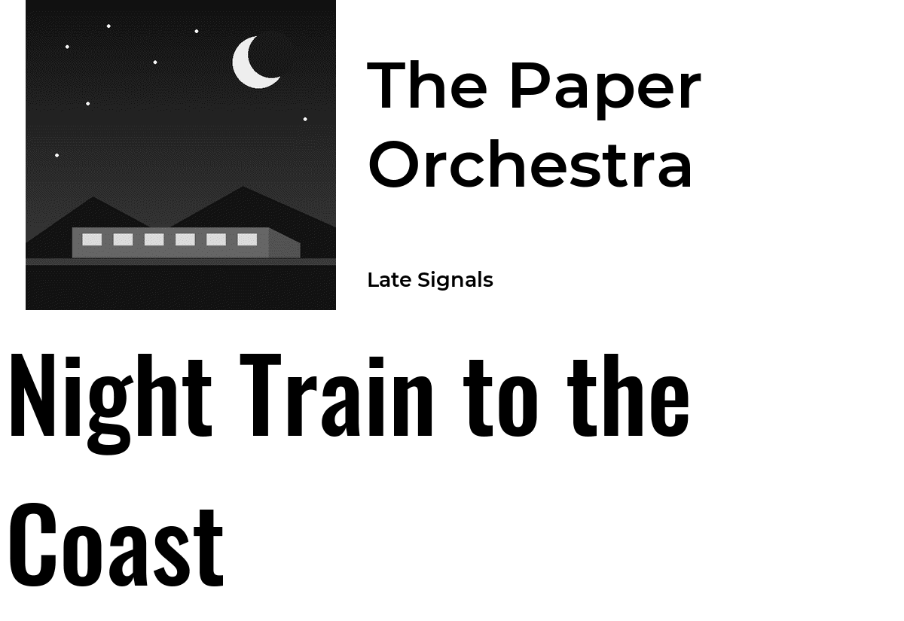
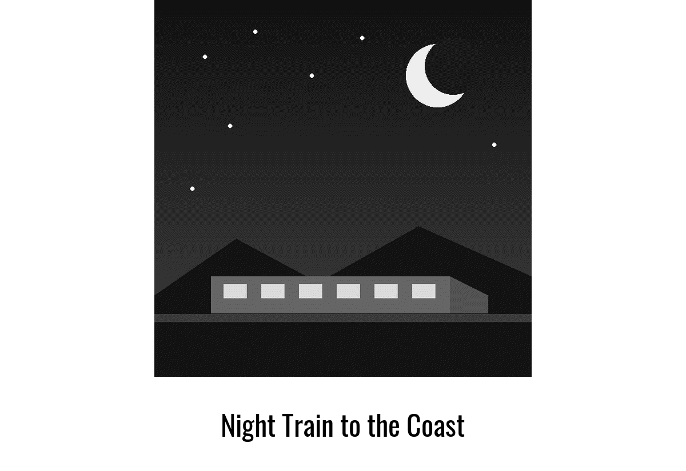
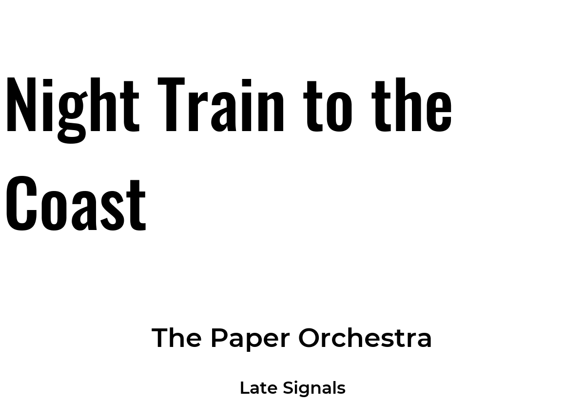
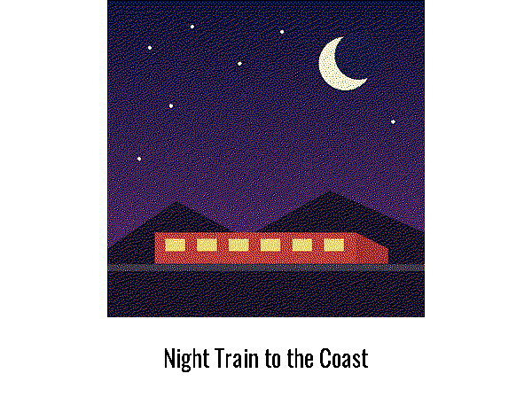

# lms_client

Shows the currently playing song, artist and album art sourced from a local [Lyrion Music Server](https://lyrion.org/) player.

This plugin typically remains dormant and invisible on PaperPi until the tracked music player starts playing. When music starts, the plugin will jump to the foreground using the `interrupt` display level and keep control of the screen until the music stops.



## What you need

- **An LMS server** on your network, for example on a Raspberry Pi or a home server ([lyrion.org](https://lyrion.org/) explains how to install one).
- **An LMS player** that plays from it: a Squeezebox, or Squeezelite (a player program) on a Raspberry Pi. The player can be on the same Pi as PaperPi or anywhere on the network.

## Set it up

1. In the PaperPi web interface, open the **Plugin Library** and add **Music server (LMS)**.
2. On its settings page, press **Find players**. The plugin will attempt to discover all of players registered on the LMS server.
3. Press **Use** next to your player. That fills in `server` and `player` settings.
4. If your LMS server has a password, fill in `user` and `password`.
5. Save, and play a song.

Note: Servers on other network segments may not be discovered automatically

A server in another network can't be found this way. Type its address (such as `192.168.1.9:9000`) in `server` and press **Find players** again to list its players. If the server has a password, fill in `user` and `password` before you press the button.

It is possible to track multiple players by adding a plugin instance for each player. Tracking multiple players may have unexpected behavior if more than one player is actively playing.

## When it is shown

While actively playing, the plugin takes over the screen. When the player stops or is switched off, the other plugins are shown again. A paused song stays on the screen for `idle_timeout` a default of 15 seconds so a short pause doesn't change the screen. This is called an interrupt plugin; [Understanding Plugin Schedules](https://txoof.github.io/PaperPi/take-turns/) explains the levels.

## Layouts

| Layout                           | Shows                                                           |
| -------------------------------- | --------------------------------------------------------------- |
| `two_column_three_row` (default) | the cover with the artist and album next to it, the title below |
| `album_art_title`                | a large cover with the title below it                           |
| `cover_art_only`                 | only the cover                                                  |
| `two_rows_text_only`             | the title and the artist                                        |
| `three_rows_text_only`           | the title, the artist and the album                             |

| `two_column_three_row` | `album_art_title` | `cover_art_only` |
|---|---|---|
|  |  |  |

| `two_rows_text_only` | `three_rows_text_only` | `album_art_title` on a color screen |
|---|---|---|
|  |  |  |

Long titles are drawn smaller; text that still doesn't fit ends with "…". Titles are in [Oswald](https://fonts.google.com/specimen/Oswald), the artist and album in [Montserrat](https://fonts.google.com/specimen/Montserrat) SemiBold, as in PaperPi v1. The layouts are the same as the [Spotify](../librespot_client/README.md) plugin's.

## Covers and radio

Songs from your LMS library show cover art from the server. Internet radio shows the station's name as the artist, and the station's picture when LMS has one. A song without a cover shows a plain picture of a record.

Each cover is downloaded once and kept in the plugin's storage folder (at most 2 MB, JPEG or PNG; on a nearly full disk it is not kept).

## When something is wrong

When the server doesn't answer, asks for a password, or has no player with that name, the plugin's card on the web interface's home page shows the error, and PaperPi tries again at the next update. After 3 failures in a row the plugin is paused for 30 minutes and the Warnings page shows it too ([Troubleshooting](https://txoof.github.io/PaperPi/troubleshooting/)). When the player plays nothing, the plugin just waits: that is not an error.

## Settings

| Setting        | Default    | Meaning                                                                                                                |
| -------------- | ---------- | ---------------------------------------------------------------------------------------------------------------------- |
| `server`       | (required) | address of the LMS server with its web port, e.g. `192.168.1.9:9000` (without a port: 9000)                            |
| `player`       | (required) | name of the player, as LMS shows it, e.g. `Kitchen` (upper and lower case don't matter)                                |
| `user`         | `""`       | user name, only when the LMS server has a password                                                                     |
| `password`     | `""`       | password, only when the LMS server has one (a secret: not shown on the settings page, and only sent to the LMS server) |
| `idle_timeout` | `15`       | seconds a paused song stays on the screen before other plugins are shown                                               |

The plugin asks for a new picture every 5 seconds unless you change `refresh`.

### Configuration Keys

```toml
[[plugin]]
id = "lms_client-3456567e"
name = "Kitchen music"
type = "lms_client"
server = "192.168.1.9:9000"
player = "Kitchen"
```

## For developers

At each update the plugin asks the LMS server through its JSON-RPC interface (`http://<server>/jsonrpc.js`) for its players, finds the one named in `player`, and asks for its status. With a password, `user` and `password` are sent with every request (HTTP basic auth). Covers come from `/music/<coverid>/cover_500x500_m.jpg`. Each update is run as a new process; the plugin saves the time a song was paused in a small file for memory. **Find players** sends a broadcast message on UDP port 3483, the way LMS players find their server.

Try it without a screen: `uv run paperpi render lms_client` (sample song), or with the song playing now: `uv run paperpi render lms_client --live --set server=192.168.1.9:9000 --set player=Kitchen`. The fonts are under the SIL Open Font License ([`fonts/Oswald-OFL.txt`](../../fonts/Oswald-OFL.txt), [`fonts/Montserrat-OFL.txt`](../../fonts/Montserrat-OFL.txt)).
