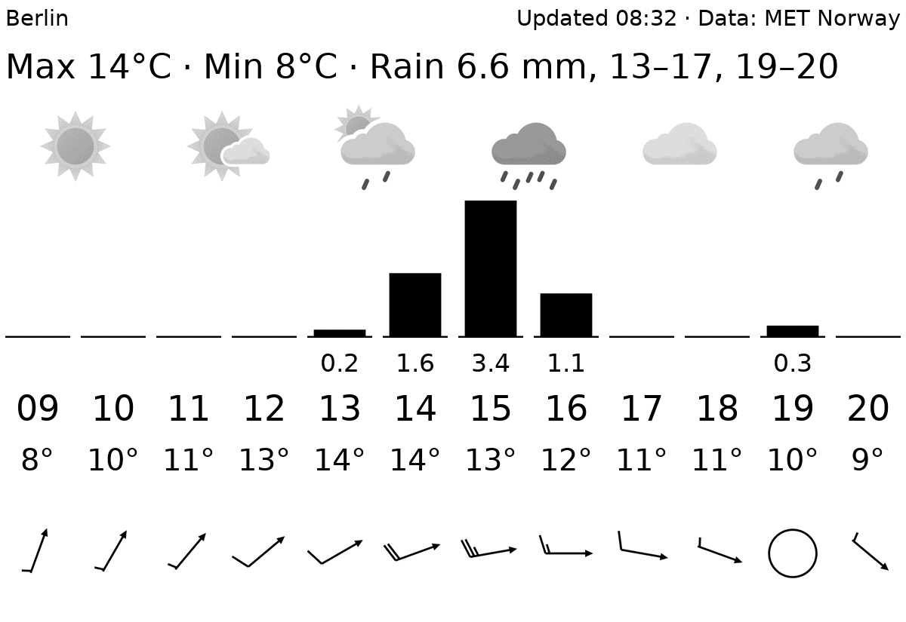
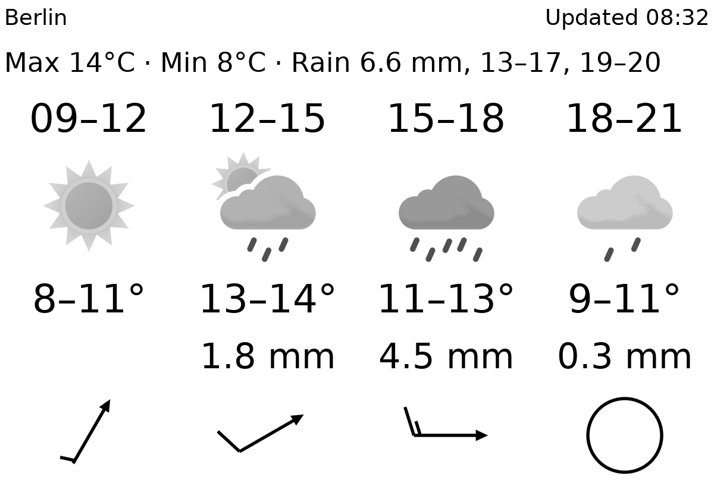
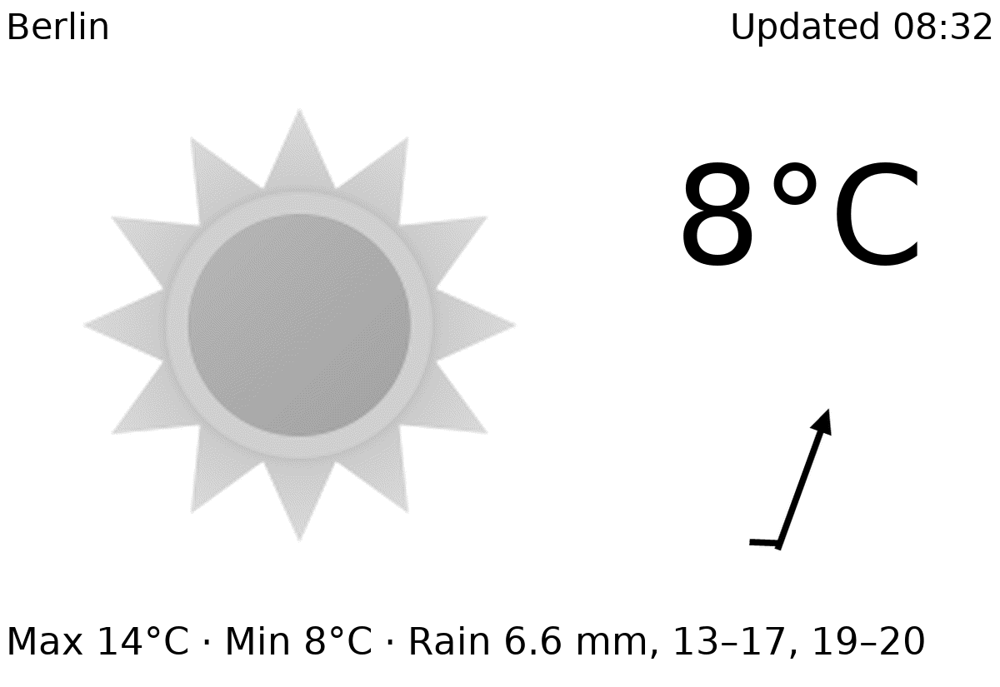
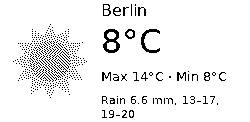
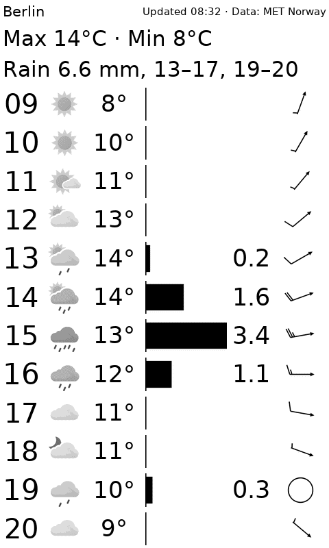
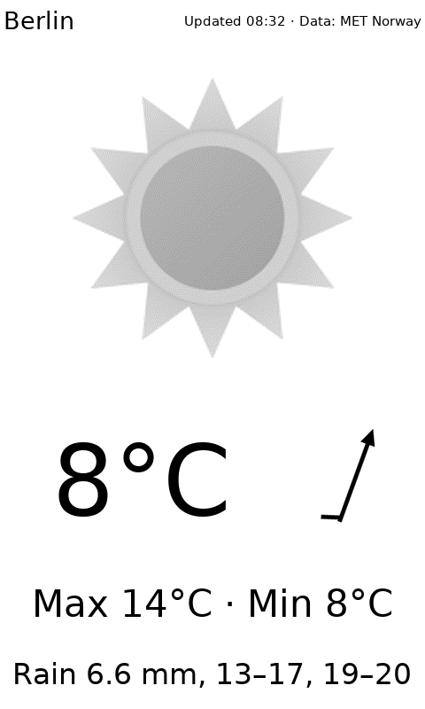
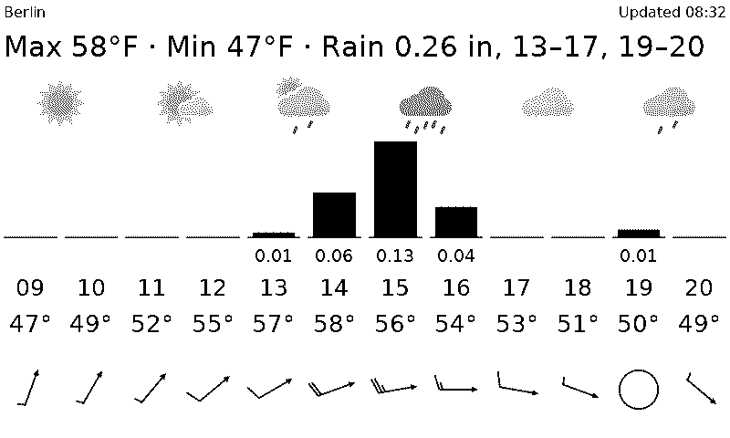

# met_no

Shows the weather for the next 12 hours at your location, from [met.no](https://api.met.no/) (the Norwegian Meteorological Institute): temperature, rain, wind and a weather icon. Free, with forecasts for places all over the world.

This plugin takes its turn with the other plugins using the `rotation` display level. It needs the internet, your location and your email address.



## Set it up

1. In the PaperPi web interface, open the **Plugin Library** and add **Weather**.
2. On its settings page, type the name of your town or city just above `lat` (e.g. `Addis Ababa`, or `Morrison, Colorado` when several places share a name) and press **Search**.
3. Press **Use** next to the right place. That fills in the `lat`, `lon`, `altitude` and `place` settings.
4. Fill in your `email`.
5. Optionally, set `temperature` to `F` and `rain` to `inch`.
6. Save.

Note: the email address is sent only to met.no, whose terms of service require contact details from every program that uses its data.

## What it shows

- **A summary for the next 12 hours:** highest and lowest temperature, total rain, and the hours it rains ("Max 14°C · Min 8°C · Rain 6.6 mm, 13–17, 19–20"; 13–17 means from 13:00 to 17:00).
- **Per hour:** a bar for the rain (the amount under it), the temperature and a wind barb.
- **A weather icon every 2 hours.**

The 12 hours start at the current hour. Times are shown in the Pi's own time zone.

## Wind barbs

A barb is a line with an arrowhead that points where the wind is **going**. The feathers at the other end give the speed in knots (1 knot is about 1.15 mph or 1.9 km/h):

| Shape                     | Speed              |
| ------------------------- | ------------------ |
| circle                    | calm, under 1 knot |
| line and arrowhead only   | 1 to 2.4 knots     |
| short feather             | 5 knots            |
| long feather              | 10 knots           |
| triangle                  | 50 knots           |
| warning triangle with "!" | over 105 knots     |

Feathers add up: a long and a short feather is 15 knots; a triangle and two long feathers is 70.

## Layouts

| Layout               | Shows                                                                               |
| -------------------- | ----------------------------------------------------------------------------------- |
| `hours_12` (default) | the summary, an icon every 2 hours, then per hour the rain, temperature and wind    |
| `steps_3h`           | the summary, then 4 steps of 3 hours: icon, lowest and highest temperature, rain, wind |
| `now`                | the current hour, large: icon, temperature and wind barb, with the summary below    |
| `small`              | for tiny screens (2" to 3"): a big icon, the temperature now, max, min and rain     |
| `portrait_hours`     | for upright screens: the summary, then one row per hour                             |
| `portrait_now`       | for upright screens: a large icon for the current hour, then the summary            |

| `hours_12` | `steps_3h` | `now` |
|---|---|---|
|  |  |  |

| `small`, 2.13" | `portrait_hours`, upright | `portrait_now`, upright | `hours_12`, °F and inches, 7.5" |
|---|---|---|---|
|  |  |  |  |

Every layout shows the place: the `place` setting, or the coordinates when it is empty. All but `small` also show the "Updated" time and "Data: MET Norway" at the top.

## When something is wrong

"Updated 08:32" at the top is when met.no last confirmed the forecast. If met.no can't be reached, the plugin keeps showing the last forecast it downloaded, and the "Updated" time shows how old it is.

Note: a saved forecast older than 6 hours is not used. Then the plugin's card on the web interface's home page shows the error, and PaperPi tries again at the next update ([Troubleshooting](https://txoof.github.io/PaperPi/troubleshooting/)). If `lat`, `lon` or `email` is missing, the plugin is not shown.

## Settings

| Setting       | Default        | Meaning                                                                                          |
| ------------- | -------------- | ------------------------------------------------------------------------------------------------ |
| `lat`         | none, required | latitude of the place, e.g. `52.52`                                                              |
| `lon`         | none, required | longitude of the place, e.g. `13.40`                                                             |
| `altitude`    | none           | height of the ground at the place, in whole meters (-500 to 9000); improves temperatures in hills and mountains |
| `email`       | none, required | your own, real email address, sent only to met.no                                                |
| `place`       | `""`           | name shown at the top, e.g. `"Berlin"`; without it, the coordinates are shown                    |
| `temperature` | `"C"`          | `"C"` (Celsius) or `"F"` (Fahrenheit)                                                            |
| `rain`        | `"mm"`         | `"mm"` or `"inch"`                                                                               |

Wind is always in knots, because the barbs are drawn in knots.

The plugin asks for a new picture every 30 minutes unless you change `refresh`. met.no updates its forecasts about once an hour.

### Configuration Keys

```toml
[[plugin]]
id = "met_no-fdb87963"
name = "Weather Berlin"
type = "met_no"
lat = 52.52
lon = 13.40
place = "Berlin"
email = "you@example.com"   # put your own, real address here
layout = "steps_3h"   # optional; without it: hours_12
```

## Credits

The weather data is from [MET Norway](https://www.met.no/en), under the [Creative Commons 4.0 BY International](https://creativecommons.org/licenses/by/4.0/) license. The screen shows "Data: MET Norway", as the license asks. The weather icons are met.no's own, from [github.com/metno/weathericons](https://github.com/metno/weathericons), under the MIT license ([`icons/LICENSE`](icons/LICENSE)).

## For developers

After every download the plugin saves the trimmed forecast in its storage folder and draws from it when met.no can't be reached (still starting at the current hour). After a change of `lat`, `lon` or `altitude` the saved forecast is not used. When a saved forecast is used for a long time, fewer than 12 hours may be left; the empty columns or rows stay empty, and the summary covers the hours that are left. Rain until midnight ends at "24" in the summary.

The plugin follows met.no's [terms of service](https://api.met.no/doc/TermsOfService): it sends your email address as contact, rounds the coordinates to 4 decimals (and sends the altitude, if set), asks "has anything changed since my last download?", and doesn't download again before the time met.no's answer gives (at most 1 hour): about one download an hour. The place search sends only the typed name to [Open-Meteo](https://open-meteo.com/en/docs/geocoding-api) (place data from GeoNames).

Try it without a screen: `uv run paperpi render met_no --set place=Berlin` (made-up sample data: a day in Berlin from 09:00, with a shower in the afternoon), or with real data: `uv run paperpi render met_no --live --set lat=52.52 --set lon=13.40 --set email=you@example.com` (put your own address in place of `you@example.com`). The `portrait_*` and `small` layouts are also drawn on the usual three test screens, where they look squeezed or large; the pictures above are at their own sizes.
