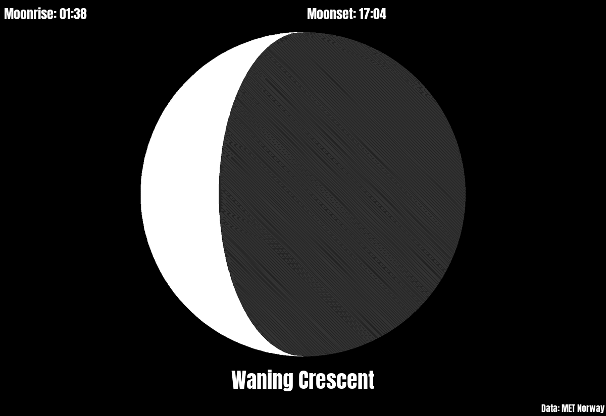
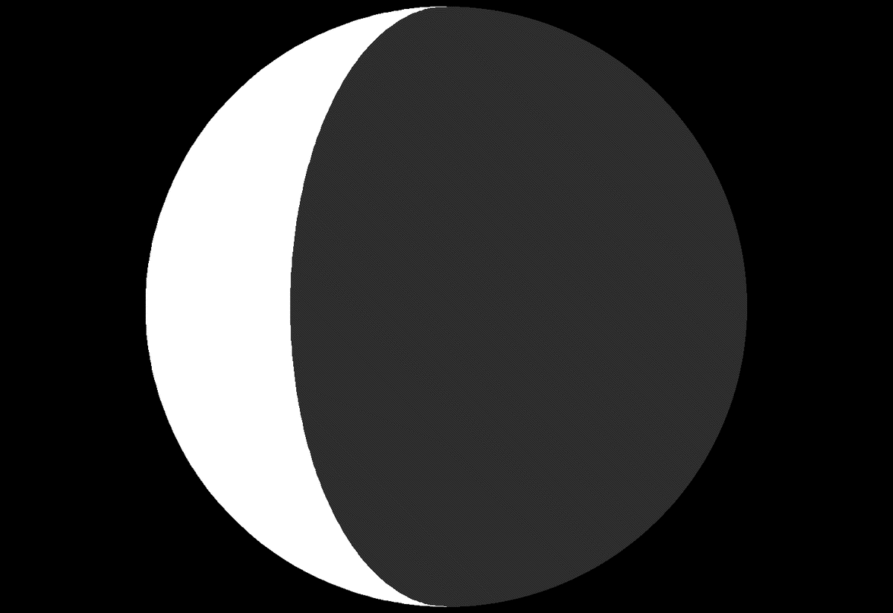
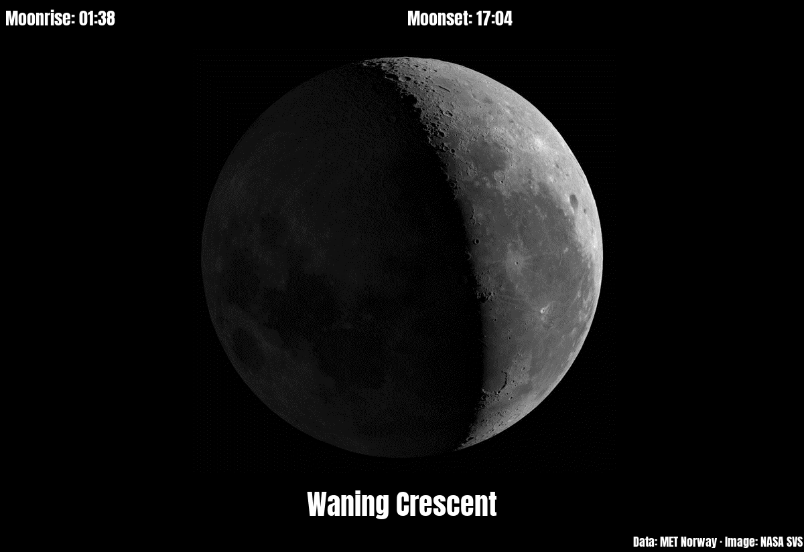
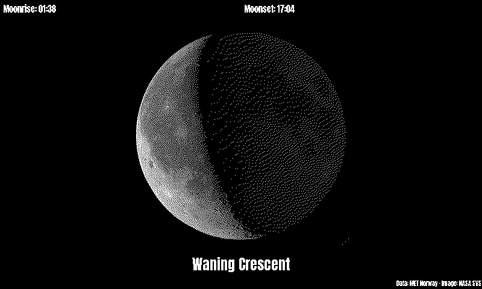

# moon_phase

Shows today's moon: a picture of its phase, the name of the phase ("Waning Crescent"), and the times it rises and sets at your location. White on black, like the night sky.

This plugin takes its turn with the other plugins using the `rotation` display level. It needs the internet, your location and your email address.



## Set it up

1. In the PaperPi web interface, open the **Plugin Library** and add **Moon phase**.
2. On its settings page, type the name of your town or city just above `lat` (e.g. `Addis Ababa`) and press **Search**.
3. Press **Use** next to the right place. That fills in the `lat` and `lon` settings.
4. Fill in your `email`.
5. Save.

Note: the email address is sent only to met.no, whose terms of service require contact details from every program that uses its data.

## Layouts

| Layout                | Shows                                                                         |
| --------------------- | ----------------------------------------------------------------------------- |
| `moon_data` (default) | moonrise and moonset on top, the moon, the name of the phase, and the credits |
| `moon_only`           | the moon only, as large as fits                                               |

| `moon_data` | `moon_only` | `moon_data`, south of the equator | `moon_data`, 7.5" black and white |
|---|---|---|---|
|  |  |  |  |

Note: south of the equator the moon looks upside down, so the picture is turned for you.

On a day the moon doesn't rise or set (about once a month), the time shows "none". Times are shown in the Pi's own time zone.

## When something is wrong

When met.no can't be reached, the plugin's card on the web interface's home page shows the error, and PaperPi tries again at the next update. After 3 failures in a row the plugin is paused for 30 minutes and the Warnings page shows it too ([Troubleshooting](https://txoof.github.io/PaperPi/troubleshooting/)). If `lat`, `lon` or `email` is missing, the plugin is not shown.

## Settings

| Setting | Default        | Meaning                                                    |
| ------- | -------------- | ---------------------------------------------------------- |
| `lat`   | none, required | latitude of the place, e.g. `52.52`                        |
| `lon`   | none, required | longitude of the place, e.g. `13.40`                       |
| `email` | none, required | your own, real email address, sent only to met.no          |

The plugin asks for a new picture every 20 minutes unless you change `refresh`. It asks met.no only once a day.

### Configuration Keys

```toml
[[plugin]]
id = "moon_phase-0df54c14"
name = "Moon"
type = "moon_phase"
lat = 52.52
lon = 13.40
email = "you@example.com"   # put your own, real address here
layout = "moon_only"   # optional; without it: moon_data
```

## Credits

The moon data is from [MET Norway](https://www.met.no/en), under the [Creative Commons Attribution 4.0 International](https://creativecommons.org/licenses/by/4.0/) license (CC BY 4.0). The `moon_data` layout shows "Data: MET Norway", as the license asks.

The moon pictures are by [NASA's Scientific Visualization Studio](https://svs.gsfc.nasa.gov/4955) (credit: NASA's Scientific Visualization Studio). NASA's pictures are generally not protected by copyright in the United States and may be used freely, as long as NASA is credited and the use does not suggest that NASA endorses PaperPi ([NASA's media usage guidelines](https://www.nasa.gov/nasa-brand-center/images-and-media/)).

## For developers

The data comes from met.no's free [sunrise service](https://docs.api.met.no/doc/sunrise/celestial.html). met.no gives one answer per place and day; the plugin saves it in its storage folder (`/var/lib/paperpi/plugins/<id>/`) and asks again only on the next day, or after a change of `lat` or `lon`. It rounds the coordinates to 4 decimals, as met.no's [terms of service](https://api.met.no/doc/TermsOfService) ask. The place search sends only the typed name to [Open-Meteo](https://open-meteo.com/en/docs/geocoding-api) (place data from GeoNames).

The pictures are 201 computer-made pictures from NASA SVS 4955 ("Moon Phase and Libration, 2022"), one for every 1.8° of the phase; the plugin shows the one nearest to today's phase angle (met.no's, in degrees: 0 new moon, 90 first quarter, 180 full moon, 270 last quarter). The names of new moon, the quarters and full moon are shown for 6° on each side. South of the equator (`lat` below 0) the picture is turned by 180°.

Try it without a screen: `uv run paperpi render moon_phase` (sample data: met.no's real answer for Berlin on 6 October 2026), or with real data: `uv run paperpi render moon_phase --live --set lat=52.52 --set lon=13.40 --set email=you@example.com` (put your own address in place of `you@example.com`). The font is Anton, under the SIL Open Font License ([`fonts/Anton-OFL.txt`](../../fonts/Anton-OFL.txt)).
