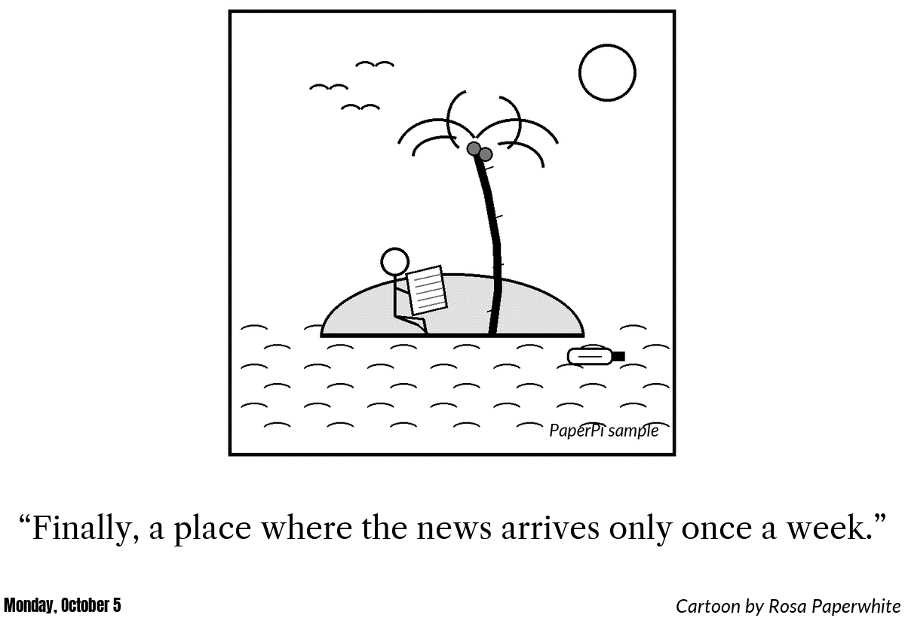
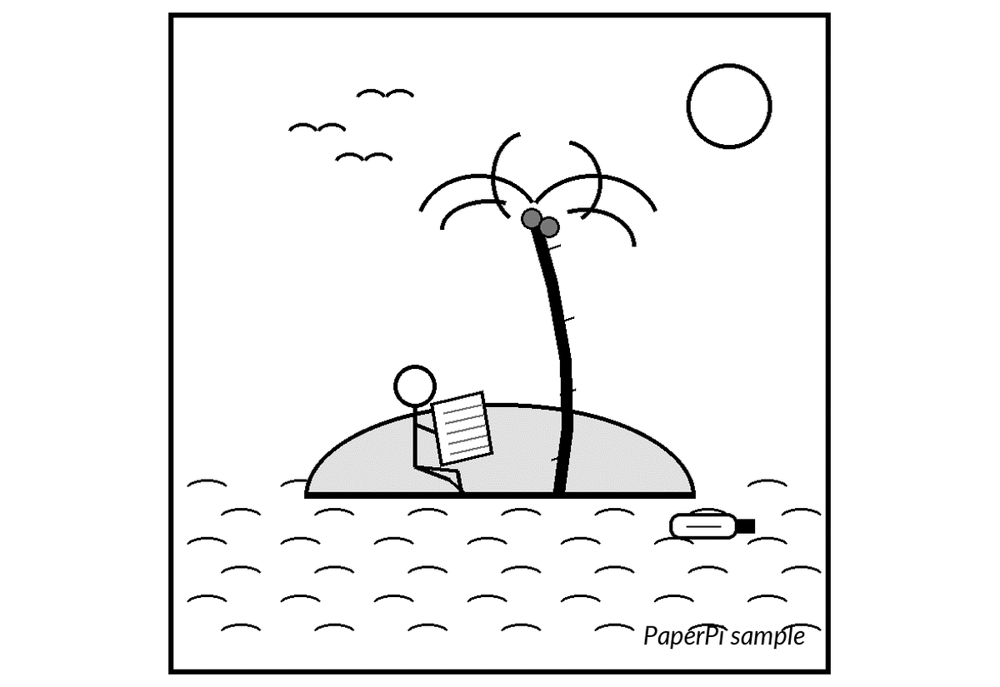

# newyorker

Shows a random cartoon from [The New Yorker](https://www.newyorker.com)'s Daily Cartoon, with its caption, the cartoonist's name and the day it came out.

This plugin takes its turn with the other plugins using the `rotation` display level. It needs the internet, but no setup.



## Set it up

1. In the PaperPi web interface, open the **Plugin Library** and add **New Yorker cartoon**.
2. Optionally, set `day_range` to `1` on its settings page to always show the newest cartoon.
3. Save.

## Which cartoon is shown

At each update the plugin picks a random cartoon from the newest `day_range` ones. The Daily Cartoon has a cartoon for most weekdays, so the default `day_range = 5` is about the last week.

Note: some cartoons have their words inside the picture and no caption: then only "Cartoon by ..." is shown.

## Layouts

| Layout                         | Shows                                                                         |
| ------------------------------ | ----------------------------------------------------------------------------- |
| `comic_caption_date` (default) | the cartoon, its caption on up to 3 lines, and the date and the cartoonist    |
| `comic_caption`                | the cartoon, its caption and the cartoonist                                   |
| `comic_only`                   | only the cartoon                                                              |

| `comic_caption_date` | `comic_caption` | `comic_only` |
|---|---|---|
|  |  |  |

Long captions are drawn smaller; text that still doesn't fit ends with "…". The caption is in [Libre Caslon Text](https://fonts.google.com/specimen/Libre+Caslon+Text), as in v1.

## When something is wrong

When no new cartoon can be downloaded, the plugin shows a random cartoon it saved earlier. If none is saved, the plugin's card on the web interface's home page shows the error, and PaperPi tries again at the next update ([Troubleshooting](https://txoof.github.io/PaperPi/troubleshooting/)).

## Settings

| Setting     | Default | Meaning                                                                                   |
| ----------- | ------- | ----------------------------------------------------------------------------------------- |
| `day_range` | `5`     | pick a random cartoon from this many of the newest ones (1 to 20; 1: always the newest)   |

The plugin asks for a new cartoon every hour unless you change `refresh`.

### Configuration Keys

```toml
[[plugin]]
id = "newyorker-7e1d832d"
name = "New Yorker"
type = "newyorker"
layout = "comic_caption"   # optional; without it: comic_caption_date
day_range = 1
```

## Credits

The cartoons and captions belong to The New Yorker and their cartoonists (© Condé Nast). PaperPi only downloads them to show on your own screen and does not share them. The sample cartoon, [`sample/therapist.png`](sample/therapist.png), its caption and its cartoonist ("Chatwell Gilbert Pennington Thurston (C.G.P.T.)") are made up: the drawing was made for PaperPi with an AI image tool and is under PaperPi's license.

## For developers

At each update the plugin downloads the Daily Cartoon feed (an RSS file with the newest cartoons, about 10), `https://www.newyorker.com/feed/cartoons/daily-cartoon`. The feed doesn't have the captions, so for each new cartoon the plugin also downloads the cartoon's page on newyorker.com (about 800 kB) and reads the caption and "Cartoon by ..." from it. When the page has changed (neither can be found, or the "caption" is longer than 400 characters), the cartoon's title and cartoonist from the feed are shown instead ("Monday, October 5th · Chris Gural"). When the page can't be downloaded, it is tried again at the next update.

The picture (a JPEG file of about 400 kB) and the texts are saved in the plugin's storage folder, so each cartoon is downloaded only once; the folder holds at most `day_range` cartoons. When the disk is nearly full, new cartoons are shown without being saved. The downloads have shorter time limits than usual (20 s for the feed, 15 s for the picture, 10 s for the page), so a saved cartoon can still be shown within the update's 60 s. Pictures and pages larger than 2 MB, and pictures larger than 4000 x 4000 pixels, are refused. Everything is downloaded only from newyorker.com and its servers, over https, also after a redirect. Only JPEG and PNG pictures are used.

Try it without a screen: `uv run paperpi render newyorker` (sample cartoon), or with a cartoon from the feed: `uv run paperpi render newyorker --live`. The sample cartoon is stored in 16 shades of gray, which keeps the file small. The date is in Anton and the cartoonist in Lato Italic. The fonts are under the SIL Open Font License ([`fonts/LibreCaslonText-OFL.txt`](../../fonts/LibreCaslonText-OFL.txt), [`fonts/Anton-OFL.txt`](../../fonts/Anton-OFL.txt), [`fonts/Lato-OFL.txt`](../../fonts/Lato-OFL.txt)).
