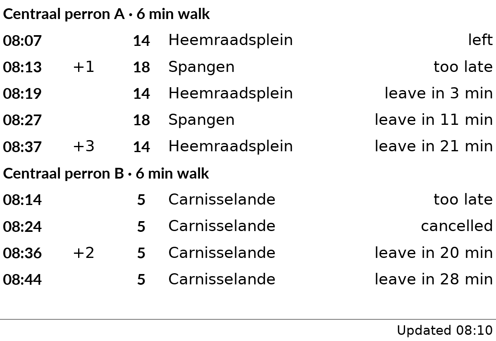

# nl_openbaar_vervoer

When the next buses and trams leave from up to four stops in the Netherlands, and when to leave the house to catch them.

## Layouts

| Layout | Shows |
|---|---|
| `sections` (default) | a heading per stop (its name, and the walking time when set), then its next departures |

Each stop gets a heading, then one row per departure: the expected time, the delay in minutes (`+3`), the line, where it goes, and a note:

- `leave in 3 min` or `leave now`: when you set a walking time for the stop. `too late`: you can't reach it any more.
- `left`: it left in the last 5 minutes. `cancelled`: it doesn't run.

The bottom line says when the times were fetched. When OVapi can't be reached, the plugin shows the departures it saved, for up to 30 minutes, and the bottom line says "Not updated since 08:10".

The times come from [OVapi](http://v0.ovapi.nl), a free service run by volunteers with the live times of all Dutch buses and trams. It needs no account or key. Please don't make the plugin update more often than once a minute (`refresh = 60`); the default is every 2 minutes.

## Settings

| Setting | Default | What it does |
|---|---|---|
| `stop_1` | (required) | Code of the stop: one side of the street, so one direction. See "Finding a stop's code" |
| `name_1` | the stop's name | Heading shown above its departures, e.g. `Tram 9` |
| `lines_1` | all lines | Only these lines, e.g. `"9, 12"` |
| `walk_1` | `0` (off) | Minutes to walk to the stop; each row then says when to leave |
| `days_1` | every day | Days on which the stop is shown, e.g. `["mon", "tue", "wed", "thu", "fri"]` |
| `stop_2` ... `stop_4` | empty | Up to three more stops, each with its own `name_`, `lines_`, `walk_` and `days_` |
| `ahead` | `60` | Minutes ahead to show departures for (10 to 80) |

The stops share the screen: one stop gets 11 rows, two get 5 each, three get 3, four get 2. On a day when no stop is shown, the plugin has nothing to show and the other plugins take its turn.

```toml
[[plugin]]
id = "trams_centraal"
type = "nl_openbaar_vervoer"
stop_1 = "31001118"
name_1 = "Centraal perron A"
lines_1 = "14, 18"
walk_1 = 6
stop_2 = "31001039"
name_2 = "Centraal perron B"
walk_2 = 6
days_2 = ["mon", "tue", "wed", "thu", "fri"]
```

## Finding a stop's code

A search by name is planned for the settings page. Until then, look the code up in OVapi:

1. Open <http://v0.ovapi.nl/stopareacode> and search the page for your stop's name (with your browser's Find), for example `Rotterdam Centraal perron A`. Note its `StopAreaCode`, e.g. `4862`.
2. Open `http://v0.ovapi.nl/stopareacode/4862` (with your code). It lists each side of the street, under a number such as `31001118`, with the lines and destinations that leave there. Pick the side that goes your way.
3. Put that number in `stop_1`.

## Limits

- Some stops are missing from OVapi's list of stop names (for example Padualaan in Utrecht), and the Utrecht trams showed no data in a test in October 2026.
- Times on the screen are as old as the last update: with the default `refresh` of 2 minutes, "leave in 3 min" can be up to 2 minutes old.
- NS trains are not shown yet; they are planned for a next version.

## Sample images

The sample data is made up: the two tram platforms at Rotterdam Centraal on a Saturday at 08:10, with a 6-minute walk. All sample images are in [`tests/images/`](../../../../tests/images/), named `nl_openbaar_vervoer-<layout>[-two-stops]-<screen>.png`, where `<screen>` is `9in7` (9.7", 1200x825, 16 grays), `7in5` (7.5", 800x480, black and white) or `5in65` (5.65", 600x448, 7 colours). Without `two-stops`, only the first platform is set.

| 9.7" | 7.5" |
|---|---|
|  |  |
