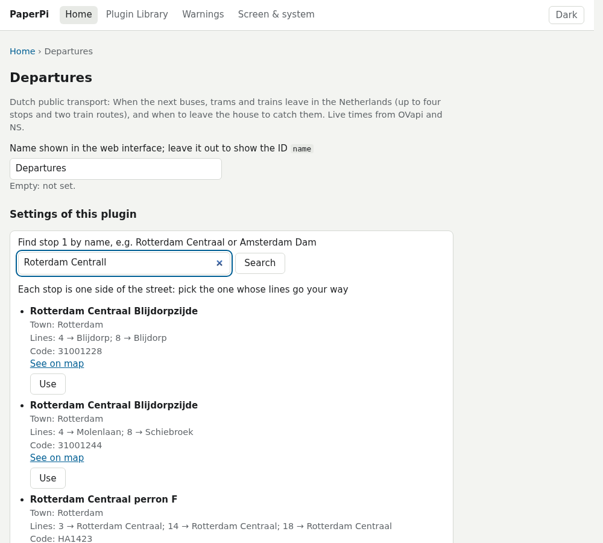

# nl_openbaar_vervoer

Shows when the next buses, trams and trains leave in the Netherlands, from up to four stops and on up to two train routes, and when to leave the house to catch them.

This plugin takes its turn with the other plugins using the `rotation` display level. With `alert_on_disruption`, it comes to the front while NS reports a disruption on a train route. It needs the internet; trains also need a free NS key.


## What you need

- **For buses and trams:** nothing. The times come from [OVapi](http://v0.ovapi.nl), a free service run by volunteers.
- **For trains:** a free key for the [NS API](https://apiportal.ns.nl). See [Getting an NS key](#getting-an-ns-key).

## Set it up

1. In the PaperPi web interface, open the **Plugin Library** and add **Dutch public transport**.
2. On its settings page, find your stop with the search box above `stop_1` (see [Finding a stop](#finding-a-stop)) and press **Use**.
3. Optionally, set `walk_1` to the minutes it takes you to walk to the stop (see [Setting the walking time](#setting-the-walking-time)).
4. For trains, fill in `ns_key`, then find the two stations of your route with the search boxes above `train_from_1` and `train_to_1`.
5. Save.

Note: the plugin needs at least one stop or one train route.

## What it shows

Each stop gets a heading, then one row per departure: the expected time, the delay in minutes (`+3`), the line, where it goes, and a note:

- `leave in 3 min` or `leave now`: when you set a walking time for the stop. `too late`: you can't reach it any more.
- `left`: it left in the last 5 minutes. `cancelled`: it doesn't run.

For a train the row also shows the type (`IC`, `SPR`), the platform in a box as on NS's signs, and the station the train is signed with (`Groningen`), which is often beyond your destination; `Groningen · was 7` when the platform changed.

The bottom line says when the times were fetched, after any disruptions (`Disruption: ...`) or planned works (`Works: ...`) that NS reports for the train routes.

## Layouts

| Layout               | Shows                                                                                              |
| -------------------- | -------------------------------------------------------------------------------------------------- |
| `sections` (default) | a heading per stop or train route, then its next departures; disruptions on the bottom line        |
| `by_time`            | the departures of all stops and routes in one list, the soonest first                              |
| `next`               | only the first stop or route: the next departure you can still catch large, the 4 after it small   |

| `sections`, 9.7" | `sections`, two stops, 7.5" |
|---|---|
|  |  |

| `by_time`, 9.7" | `next`, 7.5" |
|---|---|
|  |  |

Note: in the `sections` layout, the stops and routes shown today share the screen: one gets 11 rows, two get 5 each, three get 3, four get 2, five or six get 1.

Note: for more stops in the `next` layout, add the plugin once for each stop.

## Setting the walking time

`walk_1` (and `train_walk_1` for a train route) is the number of minutes from your front door to standing at the stop or on the platform. A tram at 08:20 with `walk_1 = 6` says "leave in ..." until 08:14, then "too late".

1. Time it once at your normal pace, or ask a map app for the walking time from your address to the stop.
2. Add what the walk leaves out: putting on a coat and locking the door, a traffic light, and for a train the stairs to the platform (2 to 5 minutes at a big station).
3. Add a minute to spare. The screen updates every 90 seconds, so "leave in 3 min" can be up to 90 seconds old.

For example, 5 minutes on the map, plus 1 for the door and 1 to spare, gives `walk_1 = 7`. Leave it at `0` to show only the times.

## Getting an NS key

1. Make a free account at <https://apiportal.ns.nl> (Sign up).
2. Under **Products**, open **Ns-App** and subscribe to it.
3. Under your **Profile**, copy the **Primary key** into `ns_key` on the plugin's settings page.

## Finding a stop

1. In the search box above the stop's code, type the stop's name, e.g. `Rotterdam Centraal` or `Amsterdam Dam`, and press **Search**. Typos are fine. When many towns have a stop of that name, add the town.
2. The list shows each side of the street as its own choice, with the lines and destinations that leave there in the next hour, and a link to a map. Pick the side whose lines go your way and press **Use**.
3. **Use** fills in the stop's code and empties its heading and lines. Change what you like, then **Save**.



Note: one side of the street is one direction, so a stop code shows departures in one direction only.

## Finding a station

Every Dutch station has a short code, such as `ASD` (Amsterdam Centraal), `RTD` (Rotterdam Centraal), `GVC` (Den Haag Centraal) and `UT` (Utrecht Centraal). In the search box above each station of a train route, type the name (`DH Centraal` and `utrcht cs` work too), press **Search**, and **Use** the right one.

Note: the station search needs `ns_key` filled in first.

## When something is wrong

When OVapi or NS can't be reached, the plugin shows the departures it saved, for up to 30 minutes, and the bottom line says "Not updated since 08:10". A stop or route with a problem (for example `Stop not found`) shows the problem in its place.

Limits:

- Some stops are missing from OVapi's list of stop names (for example Padualaan in Utrecht), and the Utrecht trams showed no data in a test in October 2026.
- A train route shows the trips NS's journey planner suggests, the same ones the NS app shows.

## Settings

| Setting                      | Default         | Meaning                                                                                 |
| ---------------------------- | --------------- | --------------------------------------------------------------------------------------- |
| `stop_1`                     | empty           | code of the stop: one side of the street, so one direction                              |
| `name_1`                     | the stop's name | heading shown above its departures, e.g. `Tram 9`                                       |
| `lines_1`                    | all lines       | only these lines, e.g. `"9, 12"`                                                        |
| `walk_1`                     | `0` (off)       | minutes to walk to the stop; each row then says when to leave                           |
| `days_1`                     | every day       | days on which the stop is shown, e.g. `["mon", "tue", "wed", "thu", "fri"]`             |
| `stop_2` ... `stop_4`        | empty           | up to three more stops, each with its own `name_`, `lines_`, `walk_` and `days_`        |
| `ns_key`                     | empty           | NS API key, needed for trains; kept secret, never shown in the web interface or the log |
| `train_from_1`, `train_to_1` | empty           | NS codes of the stations of train route 1, e.g. `GVC` and `UT`                          |
| `train_walk_1`               | `0` (off)       | minutes to walk or cycle to the station; each row then says when to leave               |
| `train_days_1`               | every day       | days on which the route is shown                                                        |
| `train_changes_1`            | `false`         | also show trips with a change of train (`Uitgeest · 1 change`); off: direct trains only |
| `train_from_2` ...           | empty           | a second route, with the same settings ending in `_2`                                   |
| `alert_on_disruption`        | `false`         | while NS reports a disruption on a train route shown today, show the plugin as an alert; planned works don't count |
| `ahead`                      | `60`            | minutes ahead to show departures for (10 to 80)                                         |

The plugin asks for new times every 90 seconds unless you change `refresh`. On a day when no stop or route is shown, the other plugins take its turn.

### Configuration Keys

```toml
[[plugin]]
id = "nl_openbaar_vervoer-6e1f3b92"
type = "nl_openbaar_vervoer"
stop_1 = "31001118"
name_1 = "Centraal perron A"
lines_1 = "14, 18"
walk_1 = 6
stop_2 = "31001039"
name_2 = "Centraal perron B"
walk_2 = 6
days_2 = ["mon", "tue", "wed", "thu", "fri"]
ns_key = "your key"
train_from_1 = "RTD"
train_to_1 = "GVC"
train_walk_1 = 6
train_days_1 = ["mon", "tue", "wed", "thu", "fri"]
```

## For developers

OVapi needs no account or key and asks for at most one request a minute: with a shorter `refresh` the plugin asks OVapi at most once a minute and shows the saved times in between. The NS key allows 5,000 requests a day. Each train route takes one or two requests (NS sends 5 trips at a time). Train times are asked for at most every 85 seconds, and disruptions every 10 minutes, so two routes stay under about 4,400 requests a day. One station search is one request.

In `by_time`, departures that already left are left out; cancelled ones and `too late` ones stay in, and a stop or route with a problem comes first. In `next`, only that stop or route is fetched, and only its disruptions show (and count for `alert_on_disruption`). In `sections` with 1 or 2 rows per stop, departures that already left are left out.

The stop search downloads OVapi's list of stops (about 650 kB) and then asks for the best matches, so the name you type goes to OVapi. Without the web interface, look up a stop at <http://v0.ovapi.nl/stopareacode> (note its `StopAreaCode`, e.g. `4862`), then open `http://v0.ovapi.nl/stopareacode/4862`: it lists each side of the street under a number such as `31001118`. Station codes are also on Wikipedia's [list of railway stations in the Netherlands](https://nl.wikipedia.org/wiki/Lijst_van_spoorwegstations_in_Nederland) ("afkorting").

The sample data is made up: the two tram platforms at Rotterdam Centraal on a Saturday at 08:10, and the trains to Den Haag Centraal with planned works, with a 6-minute walk.
