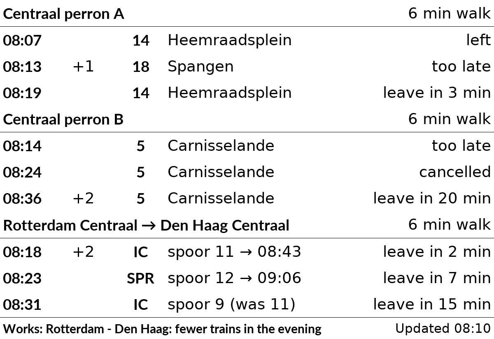
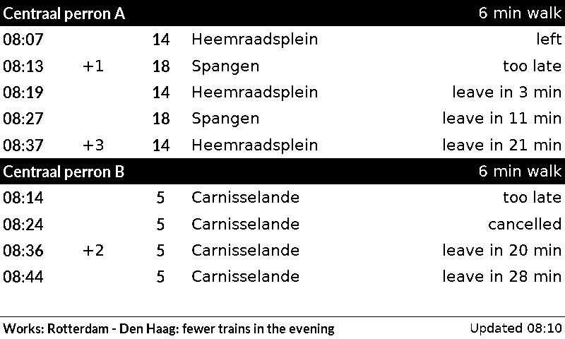
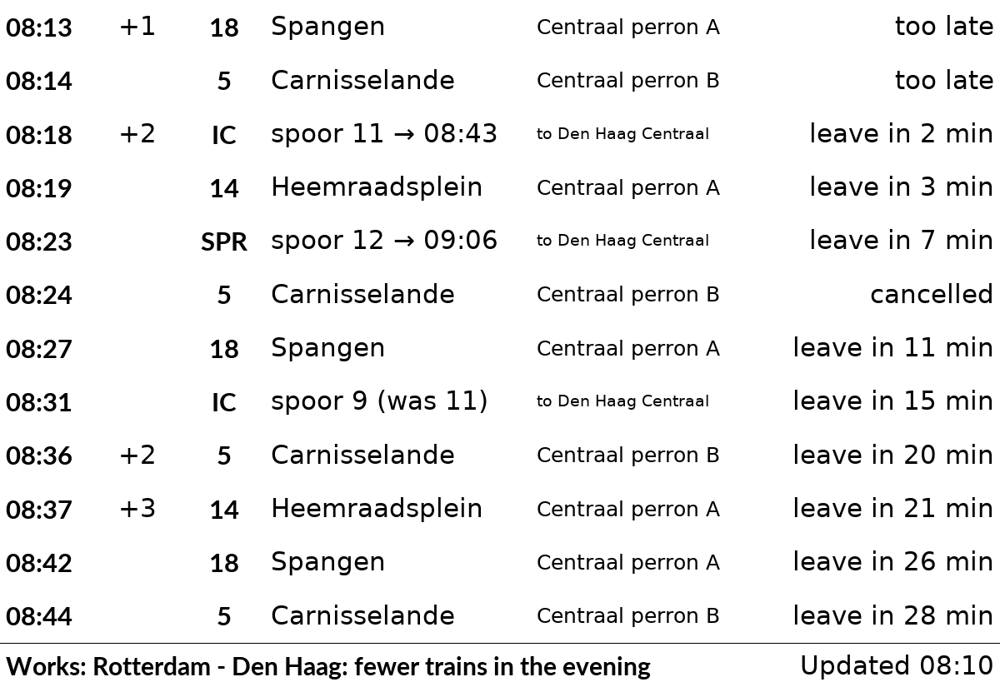
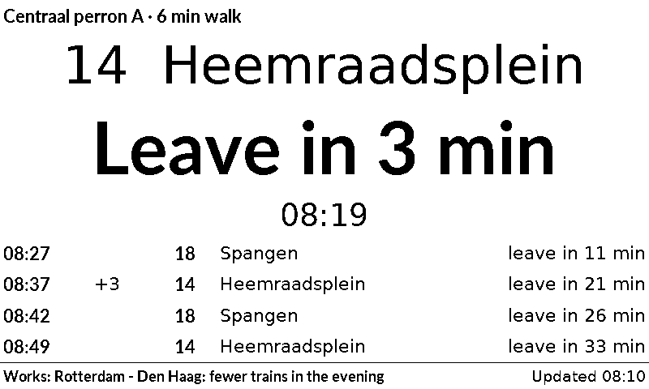

# nl_openbaar_vervoer

When the next buses, trams and trains leave in the Netherlands, from up to four stops and on up to two train routes, and when to leave the house to catch them.

## Layouts

| Layout | Shows |
|---|---|
| `sections` (default) | a heading per stop or train route (with the walking time when set), then its next departures; disruptions and planned works on the train routes on the bottom line |
| `by_time` | the departures of all stops and routes in one list, the soonest first, with the stop's heading on each row (`to Den Haag Centraal` for a train route). Departures that already left are left out; cancelled ones and ones you can't reach any more (`too late`) stay in. A stop or route with a problem (for example `Stop not found`) comes first |
| `next` | only the first stop or route shown today. The next departure you can still catch is shown large: the line and where it goes, `Leave in 3 min` (or `Leaves in 9 min` without a walking time) and its time; the 4 after it are small rows below. Only this stop or route is fetched, and only its disruptions show (and count for `alert_on_disruption`). For more stops in this layout, add one plugin entry per stop |

Choose one with `layout = "by_time"` in the plugin's entry (or on its settings page).

Each stop gets a heading, then one row per departure: the expected time, the delay in minutes (`+3`), the line, where it goes, and a note. For a train the row shows the type (`IC`, `SPR`), the platform and the arrival time (`spoor 7 → 09:47`), or `spoor 2 (was 7)` when the platform changed. The notes:

- `leave in 3 min` or `leave now`: when you set a walking time for the stop. `too late`: you can't reach it any more.
- `left`: it left in the last 5 minutes (or its time has passed). `cancelled`: it doesn't run.

The bottom line says when the times were fetched, after any disruptions (`Disruption: ...`) or planned works (`Works: ...`) that NS reports for both stations of a train route. When OVapi or NS can't be reached, the plugin shows the departures it saved, for up to 30 minutes, and the bottom line says "Not updated since 08:10".

The times come from [OVapi](http://v0.ovapi.nl), a free service run by volunteers with the live times of all Dutch buses and trams. It needs no account or key. It asks for at most one request a minute: the plugin updates every 2 minutes, and with a shorter `refresh` it asks OVapi (and NS) at most once a minute and shows the saved times in between.

Trains come from the [NS API](https://apiportal.ns.nl), which needs a free key (see "Getting an NS key"). The key allows 5,000 requests a day. Each train route takes one or two requests (NS sends 5 trips at a time). Train times are asked for at most every 110 seconds, whatever the `refresh`, and disruptions every 10 minutes, so two routes stay under about 3,500 requests a day.

## Settings

| Setting | Default | What it does |
|---|---|---|
| `stop_1` | empty | Code of the stop: one side of the street, so one direction. See "Finding a stop" |
| `name_1` | the stop's name | Heading shown above its departures, e.g. `Tram 9` |
| `lines_1` | all lines | Only these lines, e.g. `"9, 12"` |
| `walk_1` | `0` (off) | Minutes to walk to the stop; each row then says when to leave |
| `days_1` | every day | Days on which the stop is shown, e.g. `["mon", "tue", "wed", "thu", "fri"]` |
| `stop_2` ... `stop_4` | empty | Up to three more stops, each with its own `name_`, `lines_`, `walk_` and `days_` |
| `ns_key` | empty | NS API key, needed for trains. Kept secret: it is never shown in the web interface or the log |
| `train_from_1`, `train_to_1` | empty | NS codes of the stations of train route 1, e.g. `GVC` (Den Haag Centraal) and `UT` (Utrecht Centraal). See "Finding a station" |
| `train_walk_1` | `0` (off) | Minutes to walk or cycle to the station; each row then says when to leave |
| `train_days_1` | every day | Days on which the route is shown |
| `train_changes_1` | `false` | Also show trips with a change of train (`spoor 6 · 1 change`); off: direct trains only |
| `train_from_2` ... | empty | A second route, with the same settings ending in `_2` |
| `alert_on_disruption` | `false` | While NS reports a disruption on a train route shown today, show the plugin as an alert (before the other plugins). Planned works don't count |
| `ahead` | `60` | Minutes ahead to show departures for (10 to 80) |

The plugin needs at least one stop or one train route. In the `sections` layout, the stops and routes shown today share the screen, stops first: one gets 11 rows, two get 5 each, three get 3, four get 2, five or six get 1. With 1 or 2 rows, departures that already left are left out. On a day when none is shown, the plugin has nothing to show and the other plugins take its turn.

```toml
[[plugin]]
id = "nl_openbaar_vervoer-6e1f3b92"
type = "nl_openbaar_vervoer"
stop_1 = "31001118"
name_1 = "Centraal perron A"
lines_1 = "14, 18"
walk_1 = 6
stop_2 = "31001039"
name_2 = "Centraal perron B"
walk_2 = 6
days_2 = ["mon", "tue", "wed", "thu", "fri"]
ns_key = "your key"
train_from_1 = "RTD"
train_to_1 = "GVC"
train_walk_1 = 6
train_days_1 = ["mon", "tue", "wed", "thu", "fri"]
```

## Setting the walking time

`walk_1` (and `train_walk_1` for a train route) is the number of minutes from your front door to standing at the stop or on the platform. The plugin takes it off each departure time: a tram at 08:20 with `walk_1 = 6` says "leave in ..." until 08:14, then "too late".

To estimate it:

1. Time it once: walk to the stop at your normal pace, and note the minutes. Or ask a map app (OpenStreetMap, Google Maps) for the walking time from your address to the stop.
2. Add what the walk or the map leaves out: putting on a coat and locking the door, waiting at a traffic light, and for a train the stairs or lift to the platform (2 to 5 minutes at a big station).
3. Add a minute to spare. The screen updates every 2 minutes, so "leave in 3 min" can be up to 2 minutes old.

For example, 5 minutes on the map, plus 1 for the door and 1 to spare, gives `walk_1 = 7`. If you often arrive just as the tram leaves, make it a minute or two longer. Leave it at `0` to show only the times, without "leave in".

## Getting an NS key

1. Make a free account at <https://apiportal.ns.nl> (Sign up).
2. Under **Products**, open **Ns-App** and subscribe to it.
3. Under your **Profile**, copy the **Primary key** into `ns_key` (or the NS key field on the plugin's settings page).

## Finding a stop

On the plugin's settings page, each stop has a search box above its code:

1. Type the stop's name, e.g. `Rotterdam Centraal` or `Amsterdam Dam`, and press **Search** (or Enter). Typos are fine, and adding the town helps when many towns have a stop of that name.
2. The list shows each side of the street as its own choice, with the lines and destinations that leave there in the next hour, and a link to see it on a map. Pick the side whose lines go your way and press **Use**.
3. **Use** fills in the stop's code and empties its heading and lines (they belonged to the stop chosen before; an empty heading shows the stop's own name). Nothing is saved yet: change what you like, press **Preview**, then **Save**.

The search downloads OVapi's list of stops (about 650 kB) and then asks for the best matches, so the name you type goes to OVapi. A stop missing from that list (see "Limits") can't be found this way.

Without the web interface, look the code up in OVapi:

1. Open <http://v0.ovapi.nl/stopareacode> and search the page for your stop's name (with your browser's Find), for example `Rotterdam Centraal perron A`. Note its `StopAreaCode`, e.g. `4862`.
2. Open `http://v0.ovapi.nl/stopareacode/4862` (with your code). It lists each side of the street, under a number such as `31001118`, with the lines and destinations that leave there. Pick the side that goes your way.
3. Put that number in `stop_1`.

## Finding a station

Every Dutch station has a short code, such as `ASD` (Amsterdam Centraal), `RTD` (Rotterdam Centraal), `GVC` (Den Haag Centraal) and `UT` (Utrecht Centraal). On the settings page, each station of a train route has a search box: type the name (`DH Centraal` and `utrcht cs` work too), press **Search**, and **Use** the right one. The search asks NS for its list of stations, so fill in `ns_key` first (the box says so until you do); one search is one of the key's 5,000 requests a day.

Without the web interface: Wikipedia's [list of railway stations in the Netherlands](https://nl.wikipedia.org/wiki/Lijst_van_spoorwegstations_in_Nederland) gives the code of each one ("afkorting").

## Limits

- Some stops are missing from OVapi's list of stop names (for example Padualaan in Utrecht), and the Utrecht trams showed no data in a test in October 2026.
- Times on the screen are as old as the last update: with the default `refresh` of 2 minutes, "leave in 3 min" can be up to 2 minutes old.
- A route shows the trips NS's journey planner suggests, the same ones the NS app shows.

## Sample images

The sample data is made up: the two tram platforms at Rotterdam Centraal on a Saturday at 08:10, and the trains to Den Haag Centraal with planned works, with a 6-minute walk. All sample images are in [`tests/images/`](../../../../tests/images/), named `nl_openbaar_vervoer-<layout>[-two-stops|-stops-and-train]-<screen>.png`, where `<screen>` is `9in7` (9.7", 1200x825, 16 grays), `7in5` (7.5", 800x480, black and white) or `5in65` (5.65", 600x448, 7 colours). Without `two-stops` or `stops-and-train`, only the first platform is set.

| 9.7" | 7.5" |
|---|---|
|  |  |
|  |  |
