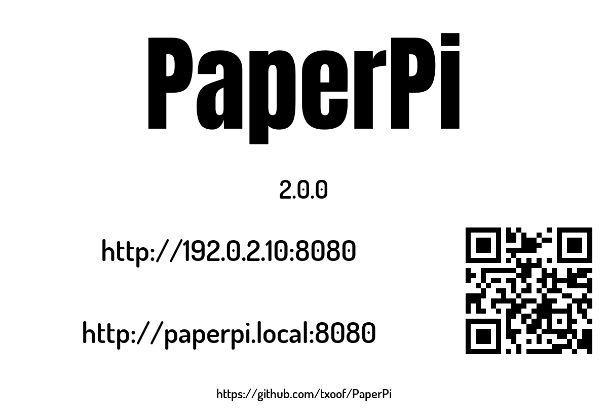
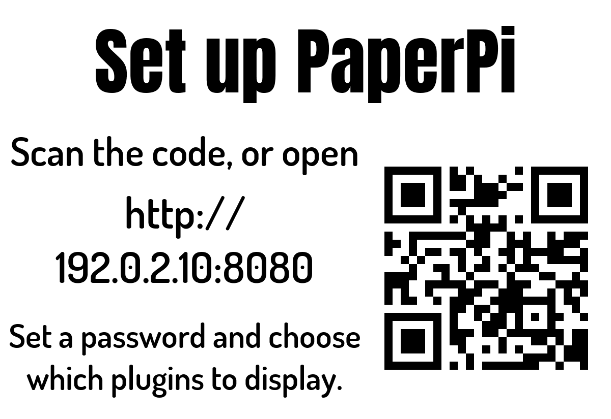

# splash_screen

Shows PaperPi's name, its version, the address of its web interface and a QR code with that address.

PaperPi shows this plugin once at start, before the other plugins, for `splash_time` seconds (60 unless you change it). It needs no setup.



## When it is shown

At start, PaperPi shows the splash screen while the other plugins get their first pictures. To change how long, set `splash_time` in `[display]` (at most 3600 seconds; `0`: not at all).

Note: when no plugin is ready to show, for example on the first start after installing, the splash screen stays on the screen until one is. So the web address to set PaperPi up is always there.

You can also add it to the rotation like any other plugin; the `setup` layout is made for that.

## What it shows

- the name, in large letters;
- the version of PaperPi that is running, for example `2.0.0`;
- the web interface's address by IP address, e.g. `http://192.0.2.10:8080`. The address can change when the router gives the Pi a new one;
- a QR code with the same address, to open the web interface on a phone;
- PaperPi's GitHub address.

Without a network it says "No network" instead, with no QR code.

## Layouts

| Layout             | Shows                                                                                                   |
| ------------------ | ------------------------------------------------------------------------------------------------------- |
| `splash` (default) | the name, the version, the web addresses next to the QR code, and the GitHub address at the bottom      |
| `setup`            | "Set up PaperPi", the web address next to a large QR code, and what to do there                         |

| `splash` | `setup` |
|---|---|
|  |  |

Note: the first config after installing ([Install](https://txoof.github.io/PaperPi/install/)) shows the `setup` layout in turn with a clock, until you remove it from the plugin list.

## Settings

| Setting | Default | Meaning                                                                                       |
| ------- | ------- | --------------------------------------------------------------------------------------------- |
| `port`  | `8080`  | the port in the addresses, only for a splash screen you add to the rotation yourself          |

The splash screen at start always uses `[web] port`. The plugin asks for a new picture every hour unless you change `refresh`, so it picks up a new IP address.

### Configuration Keys

To add it to the rotation (not needed for the splash screen at start), here with the set-up screen, as `paperpi example-config --setup` writes it:

```toml
[[plugin]]
id = "splash_screen-1fa86d6d"
name = "Set up PaperPi"
type = "splash_screen"
layout = "setup"
```

## For developers

The splash screen is a plugin like any other, so start-up needs no drawing code of its own. With no plugin ready to show, it gets a new picture every hour. The address is by IP address, not by name (`paperpi.local`), because the web interface only accepts IP addresses. A change of `[web] port` applies at the next start of PaperPi.

An address is never cut off: when it doesn't fit on one line, it is broken after a "/" (or after a "." or ":"), drawn smaller if needed, and as a last step broken between letters.

Try it without a screen: `uv run paperpi render splash_screen --size 800x480 --mode bw` (sample data: version 2.0.0 and the made-up address 192.0.2.10; `--live` shows this Pi's real addresses). The name is in [Anton](https://fonts.google.com/specimen/Anton) and the rest in [Dosis](https://fonts.google.com/specimen/Dosis) SemiBold, both as in v1 and under the SIL Open Font License ([`fonts/Anton-OFL.txt`](../../fonts/Anton-OFL.txt), [`fonts/Dosis-OFL.txt`](../../fonts/Dosis-OFL.txt)). The QR code is made with [segno](https://github.com/heuer/segno).
