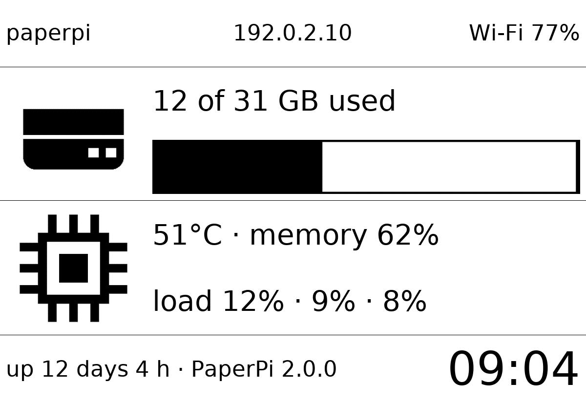
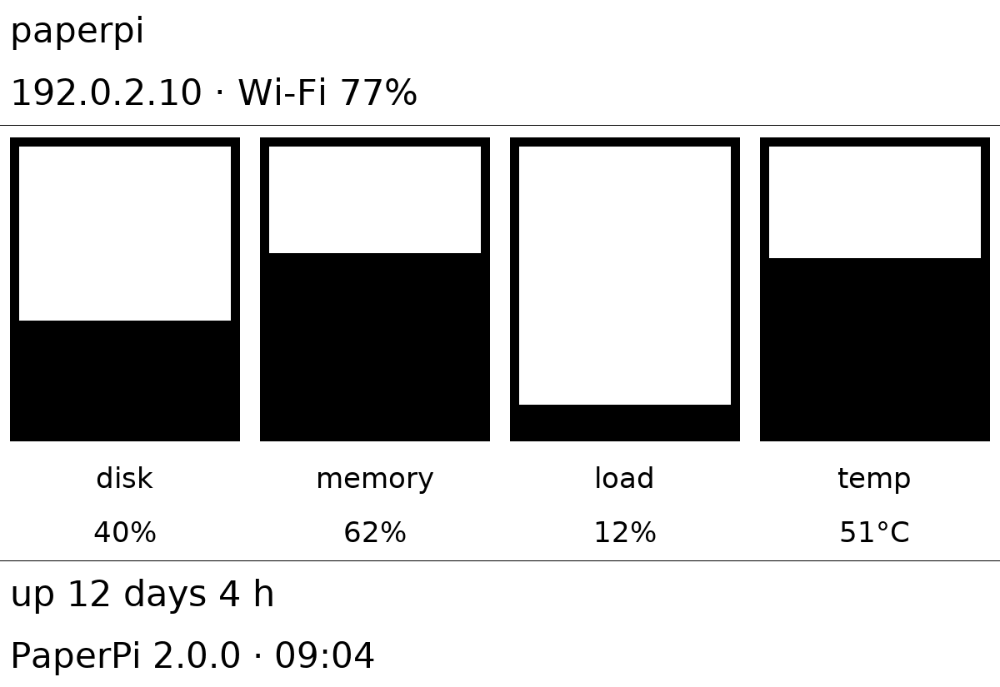
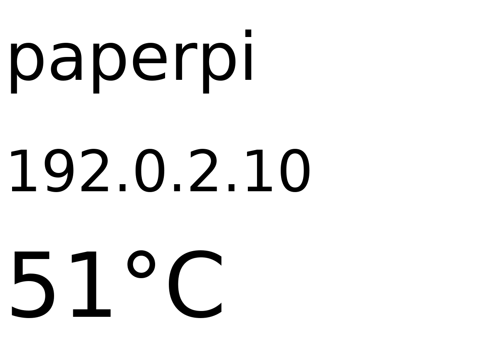

# system_info

Shows how this Pi is doing: its name and network address, Wi-Fi signal, disk space, processor temperature and load, memory use, uptime and the PaperPi version.

This plugin takes its turn with the other plugins using the `rotation` display level. It needs no network and no setup.



## Set it up

1. In the PaperPi web interface, open the **Plugin Library** and add **System info**.
2. Optionally, choose a layout for your screen (see [Layouts](#layouts)).
3. Save.

Note: the screen shows the Pi's name and network address to anyone who can see it.

## What it shows

| What        | Meaning                                                                                   |
| ----------- | ----------------------------------------------------------------------------------------- |
| Wi-Fi       | link quality in %; only shown when the Pi is on Wi-Fi, not on a cable                     |
| disk        | "12 of 31 GB used"                                                                        |
| temperature | of the processor. The Pi slows itself down from about 85 °C                               |
| load        | how busy the processor is, over 1, 5 and 15 minutes; it can go above 100 %                |
| memory      | memory in use                                                                             |

A number that can't be read is shown as "?".

## Layouts

| Layout           | Shows                                                                                       |
| ---------------- | ------------------------------------------------------------------------------------------- |
| `full` (default) | for wide screens of 5" and more: everything, with bars for disk and processor               |
| `portrait`       | for upright screens: four upright bars for disk, memory, load and temperature               |
| `small`          | for 2" and 3" screens: hostname, IP address and temperature                                 |

| `full` | `portrait` (on a wide screen) | `small` |
|---|---|---|
|  |  |  |

## Settings

| Setting            | Default   | Meaning                                                                                                          |
| ------------------ | --------- | ---------------------------------------------------------------------------------------------------------------- |
| `text_color`       | `"black"` | color of the text, lines, icons and bars: `red`, `orange`, `yellow`, `green`, `blue`, `black`, `white`, or `random` |
| `background_color` | `"white"` | color of the background, same choices                                                                            |

On gray and black-and-white screens each color becomes black or white, whichever is closer. `random` picks new colors once a day, always two that are easy to read together.

The plugin asks for a new picture every 60 seconds, just after the minute changes, unless you change `refresh`.

### Configuration Keys

```toml
[[plugin]]
id = "system_info-fe2462b4"
name = "System"
type = "system_info"
layout = "portrait"
```

## For developers

The numbers are read straight from the files Linux provides (`/proc` and `/sys`), so no extra package is needed.

- **Wi-Fi:** the Pi's own Wi-Fi chip counts link quality from 0 to 70; shown only when the address shown is the Wi-Fi's.
- **Disk:** TB from 1 TB on. Space the system keeps back for itself counts as used, so used and free add up to the total. GB here are 1,000,000,000 bytes, so the numbers differ a little from `df -h`.
- **Load:** the average number of programs running or waiting (also for the SD card), as % of all processor cores together.
- **Memory:** everything except what programs could still get.
- **portrait:** the load bar is for 1 minute, the temperature bar goes from 0 to 85 °C. On a 2.13" screen, `full` text is about 6 pixels high, so use `small` there.
- **random colors:** pairs too close in brightness, such as white and yellow, are skipped.

Try it without a screen: `uv run paperpi render system_info --live --out /tmp/system_info.png`. (Real data: written outside the repository, so this Pi's name and address can't be committed by mistake.) The sample data is made up: hostname `paperpi`, address `192.0.2.10` (a range set aside for examples).
