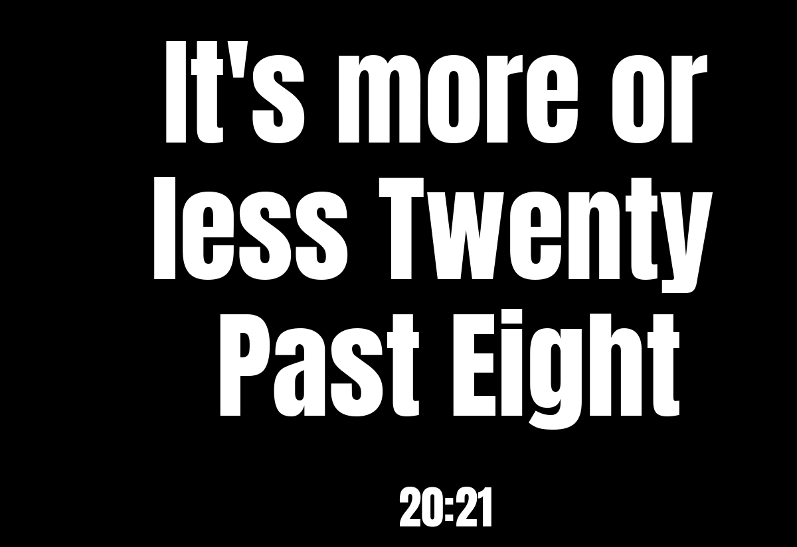
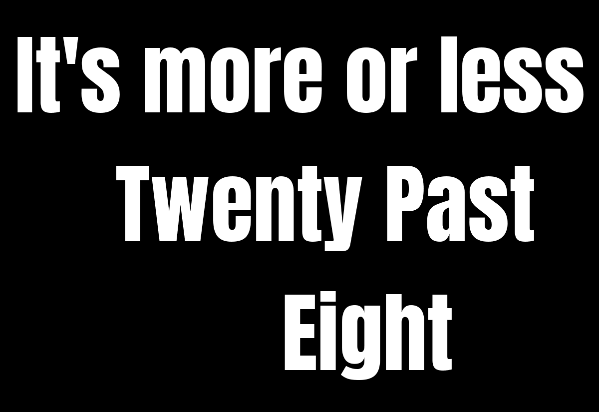
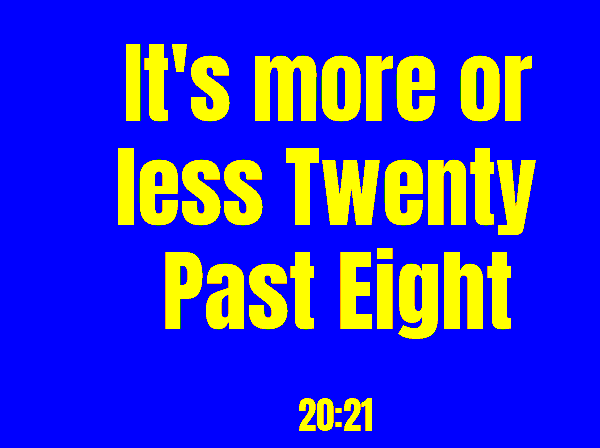

# word_clock

Shows the time in vague words, rounded to the nearest 10 minutes: "It's roughly Twenty After Eight", "It's nearly Ten 'Til Noon".

This plugin takes its turn with the other plugins using the `rotation` display level. It needs no network and no setup.



## Set it up

1. In the PaperPi web interface, open the **Plugin Library** and add **Word clock**.
2. For color displays, choose a `text_color` and `background_color` on its settings page.
3. Save.

## Layouts

| Layout                 | Shows                                                          |
| ---------------------- | -------------------------------------------------------------- |
| `words_time` (default) | the sentence, large, with the time small underneath ("20:21") |
| `words`                | the sentence only                                              |

| `words_time` | `words` | `words_time`, yellow on blue, color screen |
|---|---|---|
|  |  |  |

The font is [Anton](https://fonts.google.com/specimen/Anton).

## colors

The colors are used as they are on color screens. On gray and black-and-white screens each color becomes black or white, whichever is closer (yellow becomes white, blue black).

`random` picks a new color for each 10-minute step, always one that is easy to read with the other color (pairs too close in brightness, such as white and yellow or red and orange, are skipped).

Note: if both colors would look the same, the clock uses white on black and writes a warning to the log.

## Settings

| Setting            | Default   | Meaning                                                                                       |
| ------------------ | --------- | --------------------------------------------------------------------------------------------- |
| `text_color`       | `"white"` | color of the text: `red`, `orange`, `yellow`, `green`, `blue`, `black`, `white`, or `random` |
| `background_color` | `"black"` | color of the background, same choices                                                        |

The plugin asks for a new picture every 60 seconds, just after the minute changes, unless you change `refresh`. Each update moves the text, so the screen is written once a minute while the clock is shown.

### Configuration Keys

```toml
[[plugin]]
id = "word_clock-05f99f69"
name = "Word Clock"
type = "word_clock"
display_time = 255
text_color = "random"
background_color = "random"
```

## For developers

The text size is chosen for the sentence that needs the smallest text ("It's more or less Thirty After Go To Bed": the widest is not always the hardest, because where the lines break matters too), so every sentence fits and the size never changes. A test checks every sentence on three screen sizes. The lines sit close together (epdlib's `line_spacing: "tight"`), because Anton leaves a lot of room above its letters: 191 px on the 9.7" (v1: 178 px). At that size the 3 lines fill the whole height, so shorter words would not make it larger.

Try it without a screen: `uv run paperpi render word_clock --layout words --set text_color=yellow`. The sample time is 20:21 on Monday 5 October 2026. Anton is by The Anton Project Authors, under the SIL Open Font License ([`fonts/Anton-OFL.txt`](../../fonts/Anton-OFL.txt)), in PaperPi's shared fonts folder.
