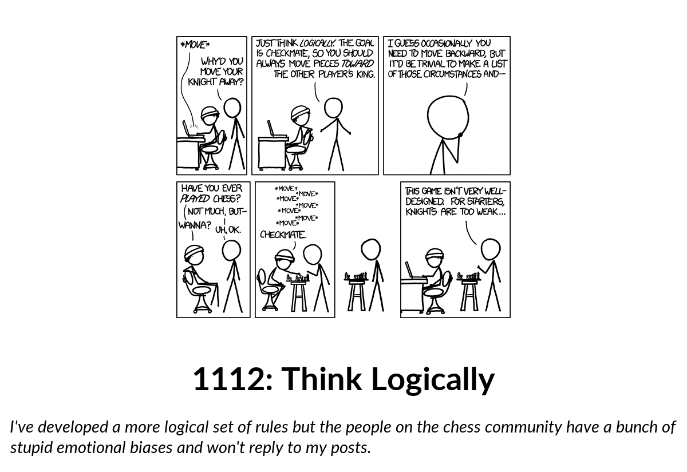
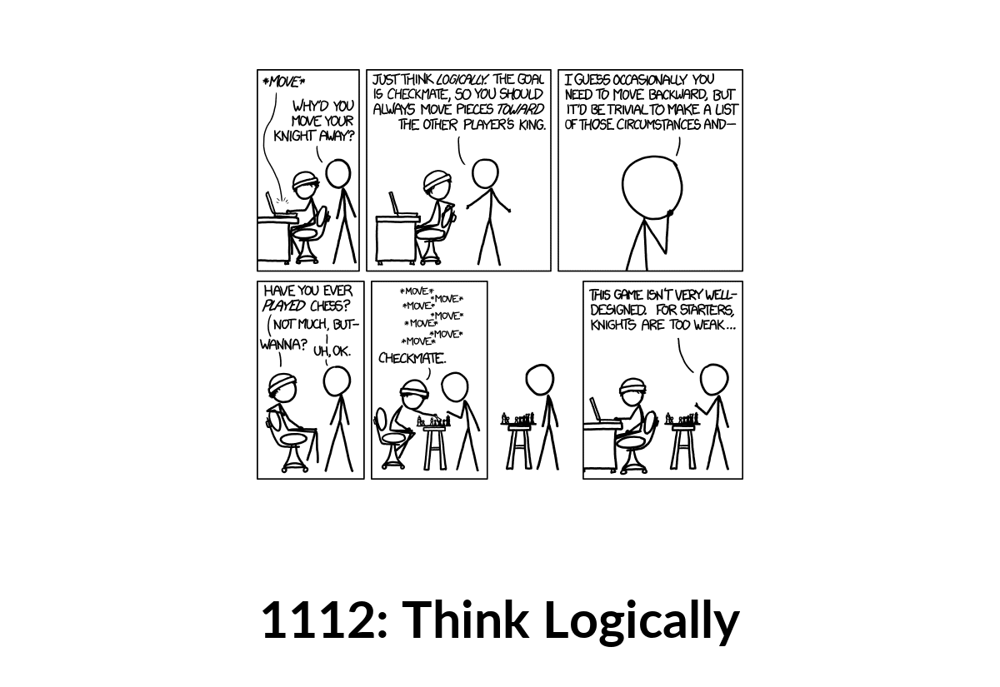
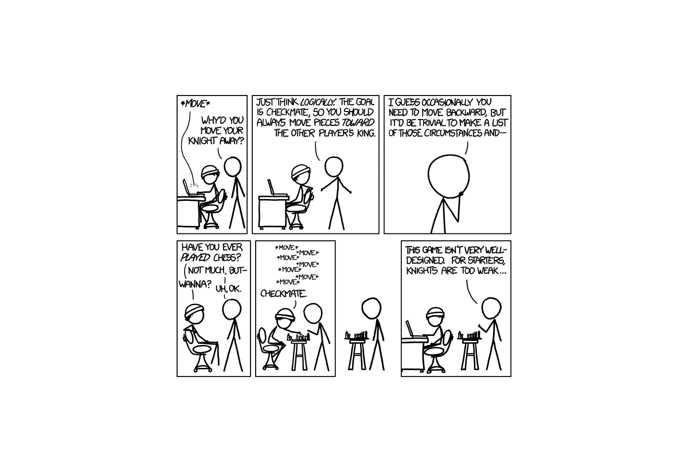

# xkcd_comic

Shows a random comic (or the newest one) from [xkcd.com](https://xkcd.com) by Randall Munroe, with its number, title and alt text.

This plugin takes its turn with the other plugins using the `rotation` display level. It needs the internet, but no setup.



## Set it up

1. In the PaperPi web interface, open the **Plugin Library** and add **xkcd**.
2. Optionally, set `comic` to `newest` on its settings page to show the newest comic instead of a random one.
3. Save.

## Which comic is shown

At each update the plugin picks a random comic, from the first one to the newest. With `comic = "newest"` it shows the newest comic instead.

Some comics are too large to read on an e-paper screen, and some are interactive pages without a picture. Those are skipped and another comic is picked, up to `tries` times.

Note: when the newest comic is too large or has no picture, that update shows a random comic, and the next update tries the newest again.

## Layouts

| Layout                          | Shows                                                                 |
| ------------------------------- | --------------------------------------------------------------------- |
| `comic_title_alttext` (default) | the comic, its title on one line, and the hover text on up to 3 lines |
| `comic_title`                   | the comic and its title, on up to 2 lines                             |
| `comic_only`                    | only the comic                                                        |

| `comic_title_alttext` | `comic_title` | `comic_only` | `comic_title_alttext` with `enlarge = false` |
|---|---|---|---|
|  |  |  |  |

Long titles and hover texts are drawn smaller; text that still doesn't fit ends with "…". The title is in [Lato](https://fonts.google.com/specimen/Lato) Bold and the hover text in Lato Italic.

## Comic size

Comics smaller than the space on the screen are enlarged to fill it, but at most to twice their own size, so their lines don't get blocky. On large screens, such as the 9.7" one, the plugin downloads xkcd's double-size picture when there is one, so the comic stays sharp. Comics larger than the space are always made smaller to fit.

With `enlarge = false` comics keep their own size.

## When something is wrong

When xkcd.com can't be reached, or none of the comics tried is suitable, the plugin's card on the web interface's home page shows the error, and PaperPi tries again at the next update. After 3 failures in a row the plugin is paused for 30 minutes and the Warnings page shows it too ([Troubleshooting](https://txoof.github.io/PaperPi/troubleshooting/)).

## Settings

| Setting      | Default    | Meaning                                                                                                     |
| ------------ | ---------- | ----------------------------------------------------------------------------------------------------------- |
| `comic`      | `"random"` | `"random"`: a random comic; `"newest"`: the newest comic (a random one when the newest can't be shown)      |
| `max_width`  | `800`      | comics wider than this many pixels are skipped (at most 4000)                                               |
| `max_height` | `600`      | comics taller than this many pixels are skipped (at most 4000)                                              |
| `tries`      | `10`       | how many random comics to try (1 to 20) before the update fails, when they are too large or have no picture |
| `enlarge`    | `true`     | enlarge comics that are smaller than the space on the screen, at most to twice their size; `false`: they keep their own size |

The plugin asks for a new comic every 20 minutes unless you change `refresh`.

### Configuration Keys

```toml
[[plugin]]
id = "xkcd_comic-33b69a4a"
name = "xkcd"
type = "xkcd_comic"
layout = "comic_title"   # optional; without it: comic_title_alttext
comic = "newest"
max_width = 1000
```

## License of the comics

The comics are Randall Munroe's work, under the [Creative Commons Attribution-NonCommercial 2.5](https://creativecommons.org/licenses/by-nc/2.5/) license (see [xkcd.com/license.html](https://xkcd.com/license.html)): they may be shared with credit, but not sold. The sample comic, [`sample/think_logically.png`](sample/think_logically.png) (xkcd 1112, "Think Logically"), and the sample images made from it are under that license, not PaperPi's; see [`sample/LICENSE`](sample/LICENSE).

## For developers

The plugin uses xkcd's own [JSON interface](https://xkcd.com/json.html). Each update downloads two small files, the newest comic's number and the chosen comic's details, and then the comic's picture (at most 5 MB; usually tens to a few hundred kB). For the newest comic, one small file is enough. Skipped comics add more downloads, and so does looking for the double-size picture (`name_2x.png`, one more download, only for comics enlarged more than 1.5 times). Pictures come only from xkcd's picture server (`imgs.xkcd.com`, over https), and only PNG, JPEG and GIF files are used. It saves nothing in its storage folder.

Try it without a screen: `uv run paperpi render xkcd_comic` (sample comic), or with a random comic from xkcd.com: `uv run paperpi render xkcd_comic --live`. Lato is by Łukasz Dziedzic, under the SIL Open Font License ([`fonts/Lato-OFL.txt`](../../fonts/Lato-OFL.txt)).
